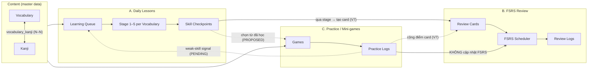
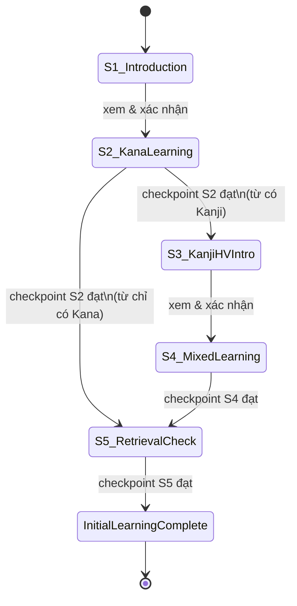
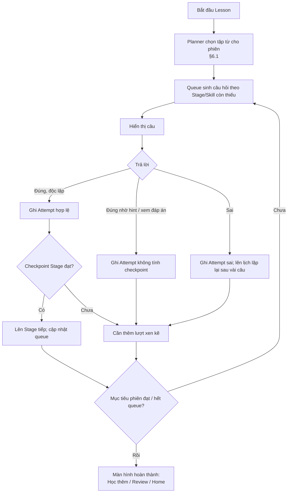
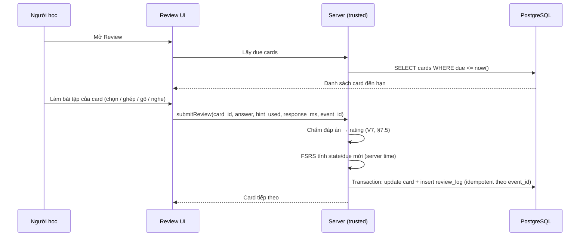
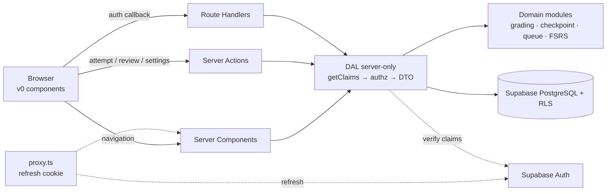
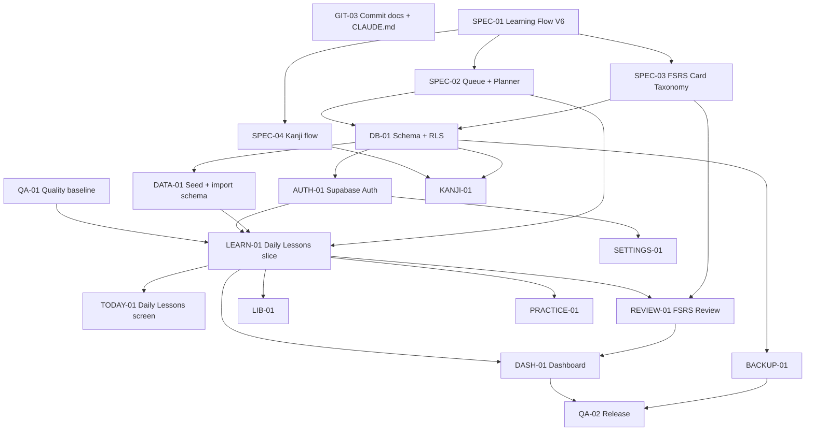

# PROJECT_SPEC — Projap (Japanese Learning App)

> **Vai trò:** Single Source of Truth cho sản phẩm, learning system, kiến trúc và trạng thái dự án.
>
> **Phiên bản:** 2.0 — Learning System Design V7
>
> **Ngày:** 2026-10-31 (V6: 2026-10-16)
>
> **Source đã kiểm tra:** repository `nihongo-app-design`, commit `afbd50d` (`chore: import original v0 UI`), branch hiện tại `docs/mvp-scope`.
>
> **Tài liệu liên quan:** `docs/ui-audit.md` (ARCH-02), `docs/mvp-scope.md` (PLAN-01), `docs/architecture.md` (ARCH-03), `docs/ux-flow-audit.md` (UX-01). Khi các tài liệu này mâu thuẫn với PROJECT_SPEC, **PROJECT_SPEC (Design V6) được ưu tiên** (xem §12.6).
>
> **Quan hệ tài liệu:** PROJECT_SPEC là bản tổng hợp cấp cao. Chi tiết kiến trúc (Auth/session, DAL, sequence diagram, ADR) nằm ở ARCH-03; chi tiết UX gap (`UXI-xx`, `FG-xx`) nằm ở UX-01. PROJECT_SPEC tham chiếu các mã này thay vì chép lại.
>
> **Ghi chú phiên bản learning flow:** ARCH-03 và UX-01 viết theo "Learning Flow V5". Tài liệu này dùng **Design V7** — chủ dự án chốt ngày 2026-10-31 (PLAN-02), thay cho các phần tương ứng của Design V6 (2026-10-16). Khác biệt V5→V6 ở §12.6; khác biệt **V6→V7 ở §17**. Nhãn **CONFIRMED (V7)** đánh dấu quyết định mới ngày 2026-10-31.
>
> **Tóm tắt V7:** nhiều người học (đăng nhập Google); nội dung cố định do server seed; lộ trình từ mới cố định; "Bài học hôm nay" gộp review FSRS bắt buộc + học stage, chia thành các phiên ~5 phút; card FSRS tạo theo từng stage; qua stage bằng điểm; Practice không đổi lịch FSRS nhưng cộng điểm card. Kế hoạch task hiện hành: tab "Tasks v2" của Google Sheet kế hoạch dự án.

## Cách đọc tài liệu

Mọi yêu cầu, thiết kế và trạng thái trong tài liệu được gắn một nhãn:

| Nhãn | Ý nghĩa | Được phép làm gì |
| --- | --- | --- |
| **CONFIRMED** | Chủ dự án đã chốt. | Dùng làm yêu cầu khi thiết kế/triển khai. Muốn đổi phải hỏi chủ dự án. |
| **PROPOSED** | Thiết kế đề xuất, hợp lý với các quyết định đã chốt nhưng chưa được duyệt. | Dùng làm điểm xuất phát cho thảo luận/ADR. **Không** triển khai như quyết định cuối khi chưa được duyệt. |
| **PENDING** | Chưa có quyết định; có thể có nhiều phương án. | Không tự chọn ngầm. Liệt kê trong §14 Open Decisions. |
| **IMPLEMENTED** | Đã xác minh trực tiếp trong source. | Mô tả đúng những gì code đang làm — kể cả khi chỉ là demo/mock. |

Bổ sung cho IMPLEMENTED:

- **IMPLEMENTED (UI demo)** — tương tác hoạt động trong browser nhưng dùng mock data hoặc React state; mất khi refresh.
- **IMPLEMENTED (placeholder)** — chỉ có card/route minh họa, chưa có chức năng.

---

## 1. Project Overview

### 1.1 Giới thiệu

Projap là web app học tiếng Nhật cá nhân, tập trung vào **Vocabulary** và **Kanji** trình độ JLPT. Ứng dụng kết hợp ba cách học độc lập: bài học ngắn hằng ngày (cảm hứng Duolingo), ôn tập theo lịch FSRS (cảm hứng Anki), và luyện tập tự do bằng mini-game.

Frontend hiện tại được tạo bằng v0 và là nền tảng UI sẽ được tái sử dụng. Repository nằm tại thư mục `nihongo-app-design`.

### 1.2 Mục tiêu — CONFIRMED

| # | Mục tiêu |
| --- | --- |
| G1 | Học Vocabulary và Kanji JLPT N5 trước, N4 sau. |
| G2 | Ghi nhớ dài hạn nhờ Active Recall và FSRS, không chỉ "xem qua". |
| G3 | Phiên học ngắn (~5 phút). Mỗi ngày hoàn thành "Bài học hôm nay" gồm một hoặc nhiều phiên; nghỉ giữa các phiên được, tiến độ trong ngày được giữ. *(V7)* |
| G4 | Tiến độ được lưu bền vững và đồng bộ giữa desktop và mobile. |
| G5 | ~~Import CSV/JSON; backup/restore~~ → **V7:** nội dung học cố định, chỉ server seed; người học không import. Backup/restore hoãn sau MVP. |
| G6 | UI Dark Modern, Minimalist, Gamified; tái sử dụng frontend v0. |
| G7 | Nhiều người học dùng chung ứng dụng, mỗi người có tiến độ, lịch ôn và settings riêng. *(V7)* |

### 1.3 Người dùng — CONFIRMED (V7)

- **Nhiều người học** (V7, thay "một người học duy nhất" của V6), người Việt, học qua tiếng Việt.
- Đăng ký / đăng nhập **chỉ bằng Google (Gmail)**; mỗi tài khoản có dữ liệu học riêng, cách ly bằng RLS.
- Dùng trên PC và điện thoại, cần cùng một tiến độ.
- Có lợi thế Hán Việt: âm Hán Việt là một kênh ghi nhớ quan trọng cho từ chứa Kanji.

Không có teacher/student hay admin portal trong MVP. Nội dung do developer quản lý qua seed (§3.9).

### 1.4 Phạm vi N5 MVP — tóm tắt

- Nội dung: Vocabulary N5 (dataset hoàn chỉnh đã có, kèm Hán Việt toàn từ và liên kết Kanji) — CONFIRMED (V7).
- Hai module trong MVP: **Bài học hôm nay** (Daily Lessons + FSRS Review gộp) và **Practice**. Module Kanji độc lập: sau MVP.
- Persistence + Google Auth + sync qua Supabase; nhiều người học.
- Không import/backup trong MVP.
- Chi tiết P0/P1/Out of Scope: §13.

---

## 2. Product Vision & Learning Philosophy

### 2.1 Triết lý học

> Học ít mỗi lần, nhớ chủ động, tăng độ khó dần, trộn lẫn nội dung và để thuật toán quyết định thời điểm ôn.

Các nguyên tắc dưới đây đều **CONFIRMED** về định hướng; con số cụ thể (thời lượng, threshold) là cấu hình khởi đầu.

| Nguyên tắc | Ý nghĩa trong Projap |
| --- | --- |
| **Micro-learning** | Một Daily Lesson ~5 phút với mục tiêu rõ. Người học có thể học thêm phiên khác hoặc nghỉ; không có "phạt" khi dừng. |
| **Active Recall** | Bằng chứng ghi nhớ đến từ việc tự nhớ lại (chọn, ghép, gõ) chứ không phải đọc lại. Câu đúng nhờ hint hoặc sau khi xem đáp án **không** tính vào checkpoint. |
| **Progressive Learning** | Mỗi từ đi qua 5 Stage: giới thiệu → nhận diện → ghép → nhớ tự do. Kana/Meaning trước, Kanji/Hán Việt sau. Thứ tự **từ mới** theo một lộ trình cố định (V7). |
| **Interleaving** | Learning Queue trộn nhiều từ, nhiều Skill, nhiều Exercise Type. Lượt đúng phải được xen kẽ, không lặp lại liên tiếp cùng một câu. |
| **FSRS** | Ôn tập dài hạn dùng thuật toán FSRS với 4 mức Again/Hard/Good/Easy. Chỉ Official Review mới thay đổi lịch FSRS. |
| **Không reset khi sai** | Sai một câu chỉ ảnh hưởng skill liên quan, không xóa tiến độ đã đạt. |
| **Checkpoint ≠ Mastery** | Đạt checkpoint nghĩa là đã có bằng chứng học ban đầu; trí nhớ dài hạn do FSRS theo dõi. Hoàn thành Stage 5 không đồng nghĩa với thành thạo. |

### 2.2 Module — CONFIRMED (V7)

V7 thay "ba module độc lập" của V6: Daily Lessons và FSRS Review được **gộp vào một luồng hằng ngày** là "Bài học hôm nay". Các loại event vẫn tách riêng (§4.1).

| Module | Cảm hứng | Vai trò | Ảnh hưởng FSRS |
| --- | --- | --- | --- |
| **Bài học hôm nay** — phần Review | Anki | Ôn card FSRS đến hạn; bài tập do máy chấm, kết quả quy ra Again/Hard/Good/Easy | **Có** — nguồn duy nhất cập nhật FSRS |
| **Bài học hôm nay** — phần học (Daily Lessons) | Duolingo | Tiếp tục từ đang học dở + học từ mới, đưa từ qua 5 Stage | Không đổi lịch; **tạo card** khi qua stage (§7.3) |
| Practice / Mini-games | Game luyện tập | Luyện tự do, vòng boss trong bài học | Không đổi lịch; cộng điểm card (§7.6) |

- **Review là bắt buộc** (V7, thay V6 "không bắt buộc ôn trước khi học mới"). Từ mới chỉ mở khi số card due còn dưới ngưỡng (§6.1).
- Bài học hôm nay chia thành các phiên ~5 phút và phải hoàn thành trong ngày.
- Module Kanji độc lập: sau MVP (OD-27).

---

## 3. Functional Requirements

Ký hiệu cột "Hiện trạng" tham chiếu §12.

### 3.1 Dashboard

| ID | Yêu cầu | Nhãn | Hiện trạng |
| --- | --- | --- | --- |
| FR-DB-01 | Hiển thị số card FSRS đến hạn và lối vào Review. | CONFIRMED (module Review tồn tại) | UI demo, số mock |
| FR-DB-02 | Nút chính "Bắt đầu học hôm nay"; hiển thị due hôm nay, từ đang học dở, từ mới còn mở, tiến độ lộ trình (x/N từ). | CONFIRMED (V7) | UI demo |
| FR-DB-03 | Hiển thị tổng Vocabulary/Kanji đã học, từ yếu. | PROPOSED (PLAN-01) | UI demo, `strength` hard-code |
| FR-DB-04 | Lối vào Practice nhanh. | IMPLEMENTED (UI demo) | `quick-training.tsx` |
| FR-DB-05 | Streak. | Ngoài MVP (V7) | UI demo, số mock |
| FR-DB-06 | Người dùng mới (chưa có dữ liệu) thấy empty state, không thấy số mock. | PROPOSED | Chưa có |

### 3.2 Daily Lessons

| ID | Yêu cầu | Nhãn |
| --- | --- | --- |
| FR-DL-01 | Phiên học ~5 phút, nhiều dạng bài tập; "Bài học hôm nay" gồm một hoặc nhiều phiên. | CONFIRMED (V7) |
| FR-DL-02 | Sau mỗi phiên có thể nghỉ hoặc học phiên tiếp; **phải hoàn thành hết các phiên trong ngày**. | CONFIRMED (V7) |
| FR-DL-03 | Mỗi Vocabulary có tiến độ Stage riêng; một bài không bắt buộc đưa từ qua đủ 5 Stage. | CONFIRMED |
| FR-DL-04 | Nội dung mỗi ngày tính động: card due + từ đang học dở + từ mới (§6.1). | CONFIRMED (V7) |
| FR-DL-05 | **Lộ trình từ mới cố định** theo thứ tự trong data (`sort_order`); không chia theo chủ đề. | CONFIRMED (V7) |
| FR-DL-06 | ~~Không bắt buộc ôn FSRS trước khi học mới~~ → **Review bắt buộc**; từ mới chỉ mở khi số due < ngưỡng. | CONFIRMED (V7) |
| FR-DL-07 | Tạm dừng và tiếp tục qua nhiều phiên mà không mất bằng chứng đã có. | CONFIRMED |
| FR-DL-08 | Học Kanji độc lập (module Kanji). | Sau MVP (V7, OD-27) |
| FR-DL-09 | "Học thêm" sau khi hết quota: lấy từ tiếp theo trong lộ trình, **mượn quota ngày mai** (tối đa 1 ngày), vẫn bị ngưỡng due chặn. Không kéo review của ngày sau lên sớm. | CONFIRMED (V7) |

Chi tiết: §5, §6.

### 3.3 Vocabulary

| ID | Yêu cầu | Nhãn |
| --- | --- | --- |
| FR-VO-01 | Mỗi từ có: cách viết (Kanji nếu có), Hiragana/Kana, Romaji, nghĩa tiếng Việt, Hán Việt toàn từ (nếu có Kanji), JLPT level. | CONFIRMED |
| FR-VO-02 | Bốn Skill S1 Meaning, S2 Kana, S3 Kanji, S4 Hán Việt. Romaji chỉ hỗ trợ phát âm. | CONFIRMED |
| FR-VO-03 | Từ chỉ có Kana không yêu cầu S3/S4 và bỏ qua Stage 3–4. | CONFIRMED |
| FR-VO-04 | Không bắt buộc học từng Kanji độc lập trước khi học từ chứa nó. | CONFIRMED |
| FR-VO-05 | Liên kết Vocabulary ↔ Kanji thành phần. | CONFIRMED (Kanji thuộc nhiều Vocabulary) |
| FR-VO-06 | Người học **loại từ khỏi lộ trình** của mình: từ chưa học thì bỏ qua; từ đã học thì card bị tạm ngưng. Khôi phục được từ Library. | CONFIRMED (V7) |
| FR-VO-07 | Mỗi từ có thể có `emoji` minh họa (tuỳ chọn). | CONFIRMED (V7) |

### 3.4 Kanji

| ID | Yêu cầu | Nhãn |
| --- | --- | --- |
| FR-KJ-01 | Mỗi Kanji có character, meanings, Hán Việt, readings. | CONFIRMED |
| FR-KJ-02 | Một Kanji có thể thuộc nhiều Vocabulary. | CONFIRMED |
| FR-KJ-03 | Module học Kanji độc lập bên cạnh Vocabulary. | CONFIRMED tồn tại — **sau MVP** (V7) |
| FR-KJ-04 | Kanji độc lập có thể có FSRS card riêng. | CONFIRMED (có thể) |
| FR-KJ-05 | Skill Taxonomy, Stage và checkpoint của Kanji độc lập. | PENDING |
| FR-KJ-06 | Lưu toàn bộ On/Kun hay chỉ readings cần thiết cho N5. | PENDING (PLAN-01 Q15) |
| FR-KJ-07 | Stroke count, components. | PROPOSED (source v0 đã có trường này trong mock) |

### 3.5 FSRS Review

| ID | Yêu cầu | Nhãn |
| --- | --- | --- |
| FR-RV-01 | Ôn theo lịch FSRS bằng **bài tập do máy chấm** (chọn, ghép, gõ, nghe); kết quả quy ra rating (§7.5). | CONFIRMED (V7) |
| FR-RV-02 | Bốn rating Again / Hard / Good / Easy. | CONFIRMED |
| FR-RV-03 | Chỉ Official Review cập nhật trạng thái FSRS. | CONFIRMED |
| FR-RV-04 | ~~Ôn độc lập~~ → Review nằm trong "Bài học hôm nay" và là phần bắt buộc. | CONFIRMED (V7) |
| FR-RV-05 | Vocabulary có nhiều card theo nhiều mục tiêu ghi nhớ. | CONFIRMED |
| FR-RV-06 | 5 loại card, tạo theo stage; card giàn giáo bỏ khi đủ điểm (§7.3–7.4). | CONFIRMED (V7) |
| FR-RV-07 | Lưu card state, due và review log append-only; chống submit trùng; server quyết định lịch. | CONFIRMED (V7) |
| FR-RV-08 | Tối đa **120** review/ngày (mặc định, chỉnh trong Settings); card cùng một từ đến hạn cùng ngày đều được hiện. | CONFIRMED (V7) |

Chi tiết: §7.

### 3.6 Practice / Mini-games

| ID | Yêu cầu | Nhãn |
| --- | --- | --- |
| FR-PR-01 | Luyện tập tự do theo kỹ năng. | CONFIRMED |
| FR-PR-02 | Mini-games: Vocabulary Matching, Kana Assembly, Kanji Assembly, Hán Việt Assembly, Speed Matching, Recall Challenge. MVP chỉ có **Speed Matching** (cả chế độ Luyện tập và vòng boss trong bài học); còn lại sau MVP. | CONFIRMED (V7 về phạm vi MVP) |
| FR-PR-03 | Lưu kết quả luyện tập. | CONFIRMED |
| FR-PR-04 | Không trực tiếp thay đổi lịch FSRS. | CONFIRMED |
| FR-PR-05 | Chỉ luyện từ đã học/đã unlock; ưu tiên từ còn card giàn giáo và từ yếu. | CONFIRMED (V7) |
| FR-PR-06 | Practice **cộng điểm card** (Again −1, Hard 0, Good +1) để bỏ card giàn giáo; không đổi `due`. Cách tính weak-skill: PENDING (OD-10). | CONFIRMED (V7) phần điểm |

Chi tiết: §8.

### 3.7 Library

| ID | Yêu cầu | Nhãn |
| --- | --- | --- |
| FR-LB-01 | Duyệt Vocabulary và Kanji theo tab. | IMPLEMENTED (UI demo) |
| FR-LB-02 | Tìm Vocabulary theo cách viết, kana, romaji, nghĩa. | CONFIRMED (V7) |
| FR-LB-03 | Xem chi tiết từ và tiến độ học: Kanji thành phần, Hán Việt, Stage, card, điểm. | CONFIRMED (V7) |
| FR-LB-04 | Đọc dữ liệu thật từ database. | CONFIRMED (V7, P0) |
| FR-LB-05 | Loại từ khỏi lộ trình / khôi phục (FR-VO-06). | CONFIRMED (V7) |
| FR-LB-06 | Không có lối "Học từ này" ngoài lộ trình trong MVP. | CONFIRMED (V7) |

### 3.8 Progress

| ID | Yêu cầu | Nhãn |
| --- | --- | --- |
| FR-PG-01 | Thống kê đã học, retention, hoạt động theo tuần. | IMPLEMENTED (UI demo, mock) |
| FR-PG-02 | Mọi số liệu tổng hợp truy vết được về attempts/reviews. | PROPOSED |
| FR-PG-03 | Hiển thị Stage của từng từ và trạng thái checkpoint từng Skill. | PROPOSED |
| FR-PG-04 | Achievements, chart nâng cao. | PROPOSED (P1) |

### 3.9 Import/Export

| ID | Yêu cầu | Nhãn |
| --- | --- | --- |
| FR-IE-01 | ~~Import Vocabulary bằng CSV/JSON~~ → Người học **không** import. Nội dung (Vocabulary, Kanji, liên kết) do server seed bằng lệnh `pnpm seed` (service role key, chỉ chạy trên máy dev/CI). | CONFIRMED (V7) |
| FR-IE-02 | Backup/restore dữ liệu người học. | Sau MVP (V7) |
| FR-IE-03 | Seed: validate toàn bộ file → dry-run báo cáo → upsert; báo lỗi theo dòng. | CONFIRMED (V7) |
| FR-IE-04 | Seed **idempotent**, upsert theo **ID ổn định** của từng item; chạy lại không nhân đôi, không làm mất tiến độ người học. Sửa nội dung = sửa file seed rồi chạy lại. | CONFIRMED (V7) |
| FR-IE-05 | Seed cả Kanji và quan hệ Vocabulary–Kanji. | CONFIRMED (V7) |
| FR-IE-06 | Restore semantics. | Sau MVP (V7) |

### 3.10 Settings

| ID | Yêu cầu | Nhãn |
| --- | --- | --- |
| FR-ST-01 | Daily goal và các switch. | IMPLEMENTED (UI demo, chỉ React state) |
| FR-ST-02 | Settings lưu theo từng người học và đồng bộ giữa thiết bị. | CONFIRMED (V7) |
| FR-ST-03 | Tham số học, mặc định: **20 từ mới/ngày**, **tối đa 120 review/ngày**, **ngưỡng due 80** (sáng có ≥ 80 card due thì không mở từ mới), chế độ **xen kẽ** (lựa chọn khác: review trước). | CONFIRMED (V7) |
| FR-ST-04 | Romaji chỉ hiện ở Stage 1–2 (kiểu `gakkou`), ẩn từ Stage 3. Furigana: PENDING. | CONFIRMED (V7) phần Romaji |

---

## 4. Complete Learning Architecture

### 4.1 Quan hệ giữa Daily Lessons, Review và Practice



- Ba module dùng chung content và identity người học, nhưng **mỗi module có loại event riêng**: `learning attempt`, `review log`, `practice log`. Không được gộp các event này làm một.
- Đường nối Daily Lessons → Review: **mỗi stage xong tạo card của stage đó** — CONFIRMED (V7, §7.3).
- V7: phần A (học) và phần B (review) được phục vụ trong cùng một luồng "Bài học hôm nay" (§6), nhưng event vẫn tách: `learning attempt` cho phần học, `review log` cho phần review.

### 4.2 Phân biệt các khái niệm cốt lõi

| Khái niệm | Thuộc module | Định nghĩa | Phạm vi | Lưu bền vững? |
| --- | --- | --- | --- | --- |
| **Bài học hôm nay** *(V7)* | Daily Lessons + Review | Toàn bộ việc học của một ngày: review đến hạn + từ đang dở + từ mới; gồm một hoặc nhiều Lesson. | Một người học × một ngày | Suy ra từ dữ liệu, không cần bảng riêng |
| **Lesson** (phiên) | Daily Lessons + Review | Một phiên ~5 phút trong Bài học hôm nay, trộn câu review và câu học. | Nhiều từ, nhiều Stage | Có (PROPOSED: `learning_sessions`) |
| **Stage** | Daily Lessons | Bước tiến trình của **một từ** (1–5). | Một Vocabulary | Có |
| **Skill** | Daily Lessons, Practice, Review | Năng lực cần nhớ của một từ: S1 Meaning, S2 Kana, S3 Kanji, S4 Hán Việt. | Một Vocabulary × một Skill | Có |
| **Exercise Type** | Daily Lessons, Practice | Dạng câu hỏi: Recognition, Assembly, Flashcard Active Recall, Free Recall… | Một câu hỏi | Thuộc tính của Attempt |
| **Attempt** | Daily Lessons | Một lần trả lời một câu: đúng/sai, có hint không, có xem đáp án không. | Một câu | Có, append-only |
| **Checkpoint** | Daily Lessons | Điều kiện để hoàn thành một Stage. V7: đạt **điểm stage** theo §5.4. | Một Vocabulary × Stage | Có |
| **Điểm stage** *(V7)* | Daily Lessons | Điểm tích lũy trong Stage hiện tại của một từ: đúng +1, hint 0, sai −1. | Một Vocabulary × Stage | Có |
| **Điểm card** *(V7)* | Review, Practice | Điểm tích lũy của một card, dùng để bỏ card giàn giáo (§7.4). | Một Review Card | Có |
| **Review Card** | FSRS Review | Đơn vị FSRS lên lịch; mỗi card có state, due, stability, difficulty. | Một Vocabulary/Kanji × một mục tiêu ghi nhớ | Có |
| **Practice Log** | Practice | Kết quả một lượt chơi/câu trong mini-game. | Một game/câu | Có |

Quan hệ: một **Lesson** chứa nhiều **Attempt**; mỗi Attempt thuộc một Vocabulary, một **Skill**, một **Exercise Type**, ở một **Stage**; đủ điểm từ Attempt hợp lệ → đạt **Checkpoint** → Vocabulary lên **Stage** tiếp và sinh **Review Card** của Stage đó (V7).

### 4.3 Trạng thái tách biệt — CONFIRMED

| Trạng thái | Câu hỏi nó trả lời | Thay đổi khi |
| --- | --- | --- |
| Checkpoint đã đạt | "Từ này đã từng chứng minh skill X đủ để qua Stage chưa?" | Đạt điều kiện; **không bị mất khi sai sau đó** |
| Sức mạnh kỹ năng hiện tại (skill strength) | "Hiện tại skill X của từ này mạnh/yếu thế nào?" | Mỗi Attempt (và có thể Practice — PENDING) |
| FSRS card state | "Khi nào cần ôn card này?" | Chỉ Official Review |

---

## 5. Vocabulary Learning Flow

### 5.1 Bốn Skill — CONFIRMED

| Skill | Tên | Mục tiêu ghi nhớ | Áp dụng cho |
| --- | --- | --- | --- |
| **S1** | Meaning | Nhớ nghĩa tiếng Việt. | Mọi từ |
| **S2** | Kana | Nhận diện và nhớ cách đọc Hiragana. | Mọi từ |
| **S3** | Kanji | Nhận diện và ghép cách viết Kanji **của từ**. | Từ có Kanji |
| **S4** | Hán Việt | Nhớ âm Hán Việt của **toàn bộ từ** (vd. HỌC HIỆU, không chỉ HỌC). | Từ có Kanji |

- **Romaji** chỉ là hỗ trợ phát âm, không phải Skill, không có checkpoint riêng.
- Romaji kiểu **`gakkou`**, chỉ hiện ở Stage 1–2. Free Recall Kana: người học gõ Romaji, ô nhập tự đổi sang Kana bằng thư viện `wanakana`; đáp án so khớp bằng Kana — CONFIRMED (V7, OD-12).

### 5.2 Năm Stage — CONFIRMED



| Stage | Tên | Nội dung | Skill được luyện |
| --- | --- | --- | --- |
| 1 | Introduction | Giới thiệu Hiragana, Romaji, Meaning. | (giới thiệu S1, S2) |
| 2 | Kana Learning | Kana → Meaning, Meaning → Kana, Hiragana Assembly, Flashcard Active Recall. | S1, S2 |
| 3 | Kanji & Hán Việt Introduction | Giới thiệu Kanji và Hán Việt toàn từ, liên kết với Kana/Meaning. | (giới thiệu S3, S4) |
| 4 | Mixed Learning | Kanji Recognition/Assembly, Hán Việt Recognition/Assembly, củng cố Meaning/Kana, Flashcard Active Recall. | S3, S4 (+ S1, S2) |
| 5 | Retrieval Check | Free Recall Meaning, Free Recall Kana, Free Recall Hán Việt (nếu áp dụng), Kanji Recall kết hợp bằng chứng Recognition/Assembly. | S1–S4 |

Hoàn thành Stage 5 = **hoàn thành vòng học ban đầu** (Initial Learning Complete), không phải Mastery.

### 5.3 Exercise Types

| Exercise Type | Mô tả | Skill | Stage | Component v0 có thể tái sử dụng |
| --- | --- | --- | --- | --- |
| Introduction Card | Xem thông tin, bấm tiếp tục. | — | 1, 3 | `flashcard-exercise.tsx`, `kanji-intro-exercise.tsx` |
| Kana → Meaning (Recognition) | Hiện Kana, chọn nghĩa. | S1 | 2, 4 | `choice-exercise.tsx` |
| Meaning → Kana (Recognition) | Hiện nghĩa, chọn Kana. | S2 | 2, 4 | `choice-exercise.tsx` |
| Hiragana Assembly | Ghép Kana từ mảnh. | S2 | 2, 4 | `assembly-exercise.tsx` (`pieceKind: 'kana'`) |
| Flashcard Active Recall | Tự nhớ rồi lật thẻ, tự đánh giá. **V7:** không tính điểm (mọi câu tính điểm đều do máy chấm). | — | (tuỳ chọn) | `japanese-flashcard.tsx` |
| Listening *(V7)* | Nghe phát âm (Web Speech API, đọc Kana) → chọn từ đúng. Thiết bị không có giọng `ja-JP` thì thay bằng dạng khác. | S1/S2 | 2, 4, Review | `choice-exercise.tsx` |
| Kanji Recognition | Hiện Kana/nghĩa, chọn cách viết Kanji đúng. | S3 | 4 | `choice-exercise.tsx` |
| Kanji Assembly | Ghép cách viết từ các chữ Kanji (có distractor). | S3 | 4, (5) | `assembly-exercise.tsx` (`pieceKind: 'kanji'`) |
| Hán Việt Recognition | Hiện từ, chọn Hán Việt toàn từ. | S4 | 4 | `choice-exercise.tsx` |
| Hán Việt Assembly | Ghép Hán Việt toàn từ từ các âm (vd. HỌC + HIỆU). | S4 | 4 | `assembly-exercise.tsx` (cần pieceKind mới — PROPOSED) |
| Free Recall | Gõ đáp án, không gợi ý. **V7:** chỉ cho Kana (gõ Romaji → Kana) và Hán Việt. **Không gõ nghĩa tiếng Việt.** | S2, S4 | 5, Review | `recall-exercise.tsx` |
| Meaning Assembly *(V7)* | Ghép nghĩa tiếng Việt từ các chữ cho sẵn (có distractor). | S1 | 5, Review | `assembly-exercise.tsx` |
| Meaning Recognition 6 *(V7)* | Chọn nghĩa đúng trong 6 đáp án (khó hơn bản 4 đáp án ở Stage 2). | S1 | 5, Review | `choice-exercise.tsx` |
| Kanji Recall (MVP) | **V7:** cả hai dạng — ghép Kanji **không gợi ý** với nhiều distractor hơn Stage 4, và chọn cách viết đúng trong 6 đáp án. | S3 | 5, Review | `assembly-exercise.tsx`, `choice-exercise.tsx` |

- Gõ Kanji bằng bàn phím Nhật **không bắt buộc** trong MVP — CONFIRMED.
- Hình thức "Hán Việt Assembly hoặc bài phù hợp thay thế" — CONFIRMED cho phép thay thế; dạng thay thế cụ thể PENDING.
- Mọi câu có đáp án là **nghĩa tiếng Việt** đều ở dạng chọn hoặc ghép, không gõ — CONFIRMED (V7, OD-14).
- Câu **Hán Việt ở Stage 5** có cả gõ (Free Recall) và chọn/ghép — CONFIRMED (V7).

### 5.4 Checkpoint từng Stage

#### Định nghĩa "lượt đúng độc lập" — CONFIRMED (định hướng)

Một Attempt chỉ được tính vào checkpoint khi **tất cả** điều kiện sau thỏa:

1. Trả lời đúng ngay lần trả lời đó.
2. Không dùng hint.
3. Không xem đáp án trước khi trả lời.
4. Được **xen kẽ** với câu khác (không phải lặp lại ngay sau một lượt của cùng từ/skill).

**Khoảng cách tối thiểu — CONFIRMED (V7, OD-04):** một câu của một từ chỉ được tính điểm (cộng **hoặc trừ**) khi có **ít nhất 4 câu khác** xen giữa nó và câu trước đó của cùng từ (câu review và câu học đều tính; câu vòng boss không tính). Mỗi Stage của một từ được cộng **tối đa +3 điểm mỗi ngày** (trần chỉ áp cho điểm cộng; ngày theo giờ Việt Nam). Vì vậy mỗi Stage tính điểm cần ít nhất 2 ngày. Chi tiết: `docs/learning-rules.md`.

#### Checkpoint bằng điểm — CONFIRMED (V7), thay threshold đếm lượt của V6

Mỗi câu trong Stage được chấm điểm: **đúng +1**, **đúng nhờ hint 0**, **sai −1**; điểm stage **có thể âm**. Qua Stage khi **đạt 5 điểm** và mỗi yêu cầu bắt buộc dưới đây có ít nhất 1 điểm.

| Stage | Điều kiện qua | Yêu cầu bắt buộc (mỗi yêu cầu ≥ 1 điểm) |
| --- | --- | --- |
| 1 | Xem xong là qua (không tính điểm). | — |
| 2 | 5 điểm | Kana → Meaning; Meaning → Kana; Hiragana Assembly |
| 3 | Xem xong là qua (không tính điểm). | — |
| 4 | 5 điểm | Kanji Recognition; Kanji Assembly; Hán Việt Recognition; Hán Việt Assembly |
| 5 | 5 điểm | Mỗi **Skill** bắt buộc của từ: S1 (Meaning Assembly hoặc Meaning Recognition 6), S2 (Free Recall Kana), S3 (Kanji Recall ghép hoặc chọn 1/6), S4 (Hán Việt gõ hoặc chọn/ghép) |

- Stage 5 yêu cầu theo Skill (không theo từng dạng bài) để 5 điểm vẫn khả thi; các dạng bài vẫn được trộn đủ.
- Từ chỉ có Kana: Stage 5 chỉ yêu cầu S1 và S2.

Cấu hình nằm trong **một module có version**, không hard-code trong UI:

```ts
// PROPOSED — minh họa hình dạng cấu hình, không phải code đã tồn tại
export const VOCAB_STAGE_RULES_V2 = {
  version: 2,
  points: { correct: 1, hint: 0, wrong: -1, passAt: 5, maxPositivePerStagePerDay: 3, floor: null },
  spacing: { minOtherWordQuestions: 4 },
  stage2: { required: ['kana_to_meaning', 'meaning_to_kana', 'hiragana_assembly'] },
  stage4: { required: ['kanji_recognition', 'kanji_assembly', 'hanviet_recognition', 'hanviet_assembly'] },
  stage5: { requiredSkills: ['S1', 'S2', 'S3', 'S4'] }, // kana-only: ['S1', 'S2']
} as const
```

#### Sai thì sao — CONFIRMED

- Sai **không** reset toàn bộ tiến độ và **không** làm mất Stage đã qua; sai chỉ trừ điểm trong Stage hiện tại (V7).
- Skill sai được đưa lại vào Learning Queue sau khi xen kẽ câu khác.
- Sai có thể giảm skill strength (cách tính PENDING).

### 5.5 Ví dụ xuyên suốt: `学校`

```text
学校 — がっこう — gakkou — Trường học — HỌC HIỆU
Kanji thành phần: 学 (HỌC), 校 (HIỆU)
Skill bắt buộc: S1 Meaning, S2 Kana, S3 Kanji, S4 Hán Việt
```

| Stage | Ví dụ câu hỏi | Kết quả cần |
| --- | --- | --- |
| 1 | Thẻ: がっこう · gakkou · Trường học → "Tiếp tục" | Xác nhận đã xem |
| 2 | (a) がっこう → chọn nghĩa: *Trường học* / Học sinh / Đại học / Giáo viên<br>(b) *Trường học* → chọn Kana: がっこう / がくせい / だいがく / せんせい<br>(c) Ghép: [が][っ][こ][う] + distractor [く][せ]<br>(d) Flashcard: "Trường học" → tự nhớ → lật | 5 điểm, có điểm từ (a), (b) và (c); (d) không tính điểm (V7) |
| 3 | Thẻ: 学校 = 学 (HỌC) + 校 (HIỆU) → HỌC HIỆU, liên kết がっこう / Trường học | Xác nhận đã xem |
| 4 | (a) がっこう → chọn cách viết: 学校 / 学生 / 大学 / 先生<br>(b) Ghép 学校 từ [学][校][生][先][大]<br>(c) 学校 → chọn Hán Việt: HỌC HIỆU / HỌC SINH / ĐẠI HỌC<br>(d) Ghép HỌC HIỆU từ [HỌC][HIỆU][SINH][TIÊN]<br>(e) Củng cố: 学校 → chọn nghĩa | 5 điểm, có điểm từ (a), (b), (c) và (d); (e) là câu củng cố (V7) |
| 5 | Ghép nghĩa của がっこう từ [trường][học][sinh][đại] · hoặc chọn nghĩa trong 6 đáp án<br>Gõ Kana của "Trường học": gõ `gakkou` → がっこう<br>Gõ Hán Việt của 学校 → "học hiệu" · hoặc chọn/ghép HỌC HIỆU<br>Kanji: ghép 学校 không gợi ý · hoặc chọn 学校 trong 6 cách viết | 5 điểm, mỗi Skill S1–S4 có ≥1 điểm (V7) |

Kết nối với database: xem §10.6.

So khớp đáp án tự do (PROPOSED, dựa trên `normalizeAnswer` đã có): Hán Việt bỏ dấu, không phân biệt hoa thường, gộp khoảng trắng; Kana so khớp sau khi đổi Romaji bằng `wanakana`. Không có gõ nghĩa tiếng Việt nên không cần xử lý đồng nghĩa (V7).

### 5.6 Từ chỉ có Kana

| Trường hợp | Ví dụ | Skill bắt buộc | Stage |
| --- | --- | --- | --- |
| Từ Hiragana thuần | これ — kore — Cái này | S1, S2 | 1 → 2 → 5 |
| Từ Katakana (ngoại lai) | テレビ — terebi — Ti vi | S1, S2 (Katakana) | 1 → 2 → 5 |
| Từ có Kanji + okurigana | 休む — やすむ — Nghỉ — HƯU | S1–S4 | 1 → 5 |

- Từ chỉ có Kana bỏ qua Stage 3–4 và Stage 5 chỉ kiểm tra S1, S2 — CONFIRMED.
- Từ Katakana: S2 dùng **đúng Katakana** của từ — mảnh ghép là Katakana, gõ Romaji ra Katakana — CONFIRMED (V7, OD-11).
- Từ có okurigana (休む): Kanji Assembly ghép **phần Kanji**, phần kana đi kèm giữ cố định; Hán Việt chỉ tính phần Kanji (HƯU) — CONFIRMED (V7, OD-11).
- Từ chỉ có Kana có duy nhất card nghĩa–hira và **giữ card này vĩnh viễn** (§7.4) — CONFIRMED (V7).

---

## 6. Daily Lesson System

### 6.1 Bài học hôm nay và phiên ~5 phút — CONFIRMED (V7)

Mỗi ngày người học bấm **"Bắt đầu học hôm nay"**. Hệ thống dựng nội dung trong ngày theo thứ tự:

1. **Card FSRS đến hạn** (gồm card dồn từ hôm trước) — tối đa **trần review/ngày** (mặc định 120).
2. **Từ đang học dở Stage** từ các ngày trước.
3. **Từ mới** theo thứ tự lộ trình (`sort_order`) — theo quota (mặc định 20 từ/ngày), **chỉ mở khi số card due đầu ngày < ngưỡng** (mặc định 80).

| Ví dụ (ngưỡng 80, trần 120) | Hôm nay |
| --- | --- |
| 50 card due | 50 review + 20 từ mới |
| 100 card due | 100 review, 0 từ mới |
| 150 card due | 120 review (chạm trần), 0 từ mới; 30 card còn lại sang ngày sau |

- Nội dung trên được chia thành các **phiên ~5 phút**. Hết một phiên có thể nghỉ hoặc làm phiên tiếp; tiến độ trong ngày được giữ. Người học **phải hoàn thành hết các phiên trong ngày**.
- **Chế độ** (Settings): *Xen kẽ* (mặc định) — câu review và câu học trộn chung một hàng đợi; *Review trước* — làm hết review rồi mới học.
- **Luật trộn hàng đợi:** không có 2 câu liền nhau cùng dạng bài; cùng một từ cách nhau ít nhất 4 câu; chèn **vòng boss** (Speed Matching 30 giây) khoảng mỗi 25 câu khi hôm nay đã có ít nhất 6 từ.
- Ngày tính theo giờ Việt Nam (UTC+7); dữ liệu lưu UTC — CONFIRMED (V7, OD-19).

### 6.2 Lesson completion

| Khái niệm | Định nghĩa | Nhãn |
| --- | --- | --- |
| Lesson completed | Đã trả lời hết câu của phiên ~5 phút. | CONFIRMED (V7) |
| Bài học hôm nay hoàn thành | Đã làm hết review trong trần và các từ của hôm nay. | CONFIRMED (V7) |
| Stage completed (của một từ) | Checkpoint Stage đó đạt. | CONFIRMED |
| Initial learning complete (của một từ) | Checkpoint Stage 5 đạt. | CONFIRMED |

Một Lesson hoàn thành **không** đòi hỏi từ nào cũng lên Stage — CONFIRMED (FR-DL-03).

### 6.3 Stage progression

- Tiến độ Stage là **per Vocabulary** và được lưu bền vững.
- Một từ có thể ở Stage 2 suốt nhiều Lesson cho tới khi đạt checkpoint.
- Không cho nhảy tự do giữa các Stage dựa trên chỉ số UI. (Source v0 hiện cho phép bấm `StageTrack` để nhảy bất kỳ bước — xem §12.6 mâu thuẫn C-05.)

### 6.4 Pause / Resume — CONFIRMED (V7)

- Attempt và review được ghi ngay khi trả lời → refresh hoặc đổi thiết bị **không mất kết quả** đã có.
- Chọn phương án **B — Session mới từ state** (OD-07): chỉ giữ kết quả đã lưu; mở lại thì tạo hàng câu hỏi mới. Không cần lưu `queue_snapshot`.

### 6.5 Học thêm khi có thời gian — CONFIRMED

Sau khi xong Bài học hôm nay: **"Học thêm"** lấy từ tiếp theo trong lộ trình và **mượn quota của ngày mai** (tối đa trước 1 ngày; vd. hôm nay học thêm 5 thì mai còn 15), vẫn bị ngưỡng due chặn. **Không** kéo review của ngày sau lên sớm vì ôn trước hạn làm giảm hiệu quả FSRS — CONFIRMED (V7).

### 6.6 Vai trò của Learning Queue — CONFIRMED (nguyên tắc)

Learning Queue là bộ máy chọn câu hỏi trong một Lesson:

- Trộn nhiều Vocabulary, Skill và Exercise Type.
- Lặp lại skill chưa đạt **sau khi** đã xen kẽ câu khác.
- Câu đúng nhờ hint hoặc sau khi xem đáp án không tính vào checkpoint độc lập.
- Không reset toàn bộ tiến độ khi sai.
- Hỗ trợ dừng và tiếp tục qua nhiều phiên.



Thuật toán chọn câu chi tiết — **PENDING** (OD-03).

### 6.7 Daily Session Planner — trạng thái V7

| Câu hỏi | Trạng thái |
| --- | --- |
| Lộ trình chủ đề hay động? | **CONFIRMED (V7):** lộ trình từ mới cố định theo `sort_order`; nội dung từng ngày tính động (§6.1). OD-01 đóng. |
| Giới hạn từ mới/ngày, review/ngày? | **CONFIRMED (V7):** 20 / 120, ngưỡng due 80, chỉnh trong Settings. OD-08 đóng. |
| Ngày học và timezone? | **CONFIRMED (V7):** giờ Việt Nam UTC+7. OD-19 đóng. |
| Số câu mỗi phiên ~5 phút; cách chia nội dung ngày thành phiên | PROPOSED: ước lượng theo số câu, tinh chỉnh khi test. |
| Ưu tiên từ nào trong số từ đang học dở? | PENDING (gợi ý: gần qua Stage trước, rồi lâu chưa gặp). |
| Lesson cho module Kanji độc lập | Sau MVP (OD-05). |

---

## 7. FSRS Review System

### 7.1 Mục tiêu — CONFIRMED

Duy trì trí nhớ dài hạn bằng lịch FSRS. **V7:** review là phần bắt buộc của "Bài học hôm nay" (§6.1), không còn là module mở riêng.

### 7.2 Review lifecycle



- Server/trusted layer chấm đáp án, quyết định thời gian review và lịch mới; browser không gửi FSRS state hay rating — CONFIRMED (V7).
- Submit trùng (cùng event) không reschedule hai lần — CONFIRMED (V7).
- Hai thiết bị submit cạnh tranh không ghi đè bằng state cũ — CONFIRMED (V7).

### 7.3 Card eligibility — CONFIRMED (V7): phương án E2

**Mỗi Stage xong tạo card của Stage đó** (OD-06 đóng):

| Qua Stage | Card được tạo |
| --- | --- |
| 1 | — |
| 2 | `vocab.meaning_kana` (nghĩa – hira) |
| 3 (xem xong) | `vocab.kana_hanviet` (hira – Hán Việt) |
| 4 | `vocab.meaning_kanji` (nghĩa – Kanji); `vocab.kanji_meaning_hanviet` (Kanji – nghĩa/Hán Việt) |
| 5 | `vocab.meaning_hanviet` (nghĩa – Hán Việt) |

Từ chỉ có Kana (1 → 2 → 5) chỉ có `vocab.meaning_kana`.

Các phương án đã cân nhắc (lưu lại để tham khảo):

| Phương án | Mô tả | Ưu | Nhược |
| --- | --- | --- | --- |
| E1 | Sau khi đạt Stage 5 (Initial learning complete), tạo toàn bộ card của từ. | Đơn giản, rõ ràng. | Từ kẹt ở Stage 4 lâu không được ôn. |
| E2 | Mỗi card được tạo khi skill tương ứng đạt checkpoint (vd. card Meaning sau Stage 2). | Ôn sớm, chi tiết. | Phức tạp hơn, nhiều card hơn. |
| E3 | Tạo card khi bắt đầu học, nhưng chỉ active khi đạt điều kiện. | Dễ quản lý ID. | Cần trạng thái "suspended/inactive". |

ARCH-03 §7.3 mô tả E1 ("đạt Stage 5 → eligible") — **không còn áp dụng**, V7 chọn E2.

### 7.4 Card taxonomy — CONFIRMED (V7, OD-02)

| Card | Nội dung ôn | Áp dụng | Loại |
| --- | --- | --- | --- |
| `vocab.meaning_kana` | nghĩa ↔ がっこう | Mọi từ | **Giàn giáo** với từ có Kanji: bỏ khi đạt **30 điểm card**. Từ chỉ có Kana: giữ vĩnh viễn |
| `vocab.kana_hanviet` | がっこう ↔ HỌC HIỆU | Từ có Kanji | **Giàn giáo**: bỏ khi đạt **40 điểm card** |
| `vocab.meaning_kanji` | nghĩa → 学校 | Từ có Kanji | Giữ |
| `vocab.kanji_meaning_hanviet` | 学校 → nghĩa / HỌC HIỆU | Từ có Kanji | Giữ |
| `vocab.meaning_hanviet` | nghĩa ↔ HỌC HIỆU | Từ có Kanji | Giữ |
| `kanji.*` | 学 → HỌC / nghĩa | Kanji độc lập | Sau MVP |

- **Điểm card:** review FSRS Again −1, Hard 0, Good +1, Easy +2; practice Again −1, Hard 0, Good +1, **tối đa +3 điểm từ practice mỗi card mỗi ngày**. Điểm card có thể âm.
- Card mới tạo được ôn lần đầu **từ ngày học hôm sau** (không ôn ngay trong ngày vừa học).
- Card bị bỏ (`retired_at`) không còn được lên lịch; lịch sử review vẫn giữ.
- Từ bị người học loại khỏi lộ trình (FR-VO-06): card chuyển `suspended`, khôi phục được.

### 7.5 FSRS scheduling

| Mục | Nhãn |
| --- | --- |
| Thuật toán FSRS; rating Again/Hard/Good/Easy | CONFIRMED |
| Library: `ts-fsrs`, đặt ở lớp riêng (domain module), không nằm trong UI | CONFIRMED (V7, OD-17) |
| Parameters mặc định, có optimize sau không | PENDING (MVP dùng mặc định) |
| Desired retention | PENDING (MVP dùng mặc định của `ts-fsrs`) |
| Giới hạn review/ngày: 120 mặc định, chỉnh trong Settings | CONFIRMED (V7) |
| **Chấm tự động → rating:** sai → Again; đúng nhờ hint → Hard; đúng → Good; Easy = đúng, không hint, dưới 3 giây, **chỉ cho bài gõ hoặc ghép** (trắc nghiệm tối đa Good) | CONFIRMED (V7) |
| Rating hiển thị dự báo interval | Không cần (người học không tự chọn rating) — V7 |

### 7.6 Official Review vs Practice — CONFIRMED

| | Official Review | Practice / Mini-game | Daily Lesson Attempt |
| --- | --- | --- | --- |
| Mục đích | Ôn đúng hạn | Luyện tự do | Học ban đầu |
| Cập nhật FSRS | **Có** | **Không** | Không trực tiếp |
| Lưu | `review_logs` | `practice_logs` | `learning_attempts` |
| Ảnh hưởng checkpoint | Không | Không | Có (điểm stage) |
| Cộng **điểm card** *(V7)* | Có: −1 / 0 / +1 / +2 | Có: −1 / 0 / +1 | Không |
| Ảnh hưởng skill strength | PENDING | PENDING | Có |

### 7.7 Card Taxonomy — trạng thái V7

1. Số card mỗi Vocabulary: tối đa 5 (§7.4) — CONFIRMED (V7).
2. Card cho từ chỉ có Kana: 1 card `vocab.meaning_kana`, giữ vĩnh viễn — CONFIRMED (V7).
3. Card Kanji độc lập trùng mục tiêu với card của từ: để module Kanji (sau MVP).
4. Sibling burying: **không** — card cùng một từ đến hạn cùng ngày đều được hiện — CONFIRMED (V7).
5. Định dạng trả lời: bài tập do máy chấm, không tự đánh giá — CONFIRMED (V7).
6. Card eligibility: E2 (§7.3) — CONFIRMED (V7).

---

## 8. Practice & Gamification

### 8.1 Các dạng bài tập và mini-games — CONFIRMED (danh sách)

| Mini-game | Skill | Mô tả ngắn | Hiện trạng source |
| --- | --- | --- | --- |
| Vocabulary Matching | S1/S2 | Nối từ với nghĩa. | Chưa có riêng |
| Kana Assembly | S2 | Ghép Kana. | Có exercise trong session, chưa là game |
| Kanji Assembly | S3 | Ghép cách viết Kanji. | Có exercise trong session, chưa là game |
| Hán Việt Assembly | S4 | Ghép âm Hán Việt. | Chưa có |
| Speed Matching | S1/S2 | Nối nhanh trong thời gian giới hạn. | **IMPLEMENTED (UI demo)**: 60 giây, mock data, không lưu |
| Recall Challenge | S1–S4 | Gõ đáp án nhanh. | Chưa có (v0 có card "Recall Sprint" placeholder) |

Source v0 còn có card "Rapid Fire" (placeholder) và "Word Builder" (link sang learning session) — chưa nằm trong danh sách CONFIRMED (xem C-08).

**Phạm vi MVP — CONFIRMED (V7, OD-15):** chỉ **Speed Matching**, dùng ở hai nơi: chế độ Luyện tập (60 giây) và **vòng boss** trong Bài học hôm nay (30 giây). Các mini-game khác và Rapid Fire: sau MVP.

### 8.2 Yêu cầu Practice — CONFIRMED

- Luyện tập tự do theo kỹ năng.
- Lưu kết quả luyện tập.
- Không trực tiếp thay đổi lịch FSRS.

- Chỉ dùng từ đã học; ưu tiên từ còn card giàn giáo và từ yếu — CONFIRMED (V7).
- Kết quả cộng **điểm card** (§7.6) nhưng không đổi `due` — CONFIRMED (V7).
- PROPOSED: game settings thật sự tác động game và được lưu.

### 8.3 XP / Progress

| Mục | Nhãn |
| --- | --- |
| UI gamified (XP, streak, achievement, mascot) | CONFIRMED (định hướng UI) |
| Công thức XP | PENDING (v0 demo: `XP = số câu đúng × 10`) |
| Streak | Ngoài MVP (V7) |
| Hiệu ứng nhỏ: thẻ "lên stage" khi một từ qua Stage, lật thẻ がっこう → 学校 ở Stage 3, màn "Xong hôm nay" | CONFIRMED (V7) |
| Achievement system | PROPOSED P1 |
| Practice có ảnh hưởng weak-skill signal | PENDING |

---

## 9. Technical Architecture

### 9.1 Stack — quyết định vs đã tích hợp

| Thành phần | Quyết định | Trạng thái trong source |
| --- | --- | --- |
| Next.js App Router | CONFIRMED | IMPLEMENTED — `next` 16.4.0 |
| React + TypeScript | CONFIRMED | IMPLEMENTED — React 19, TS 5.7.3, `strict` |
| Tailwind CSS | CONFIRMED | IMPLEMENTED — Tailwind 4.3.3 |
| pnpm | CONFIRMED | IMPLEMENTED — `pnpm@12.3.4`, `pnpm-lock.yaml` |
| Supabase | CONFIRMED | **Chưa tích hợp** — không có dependency/client |
| PostgreSQL | CONFIRMED (qua Supabase) | **Chưa tích hợp** |
| Supabase Auth | CONFIRMED | **Chưa tích hợp** — không có auth/protected route |
| Next.js full-stack (BFF), không backend riêng | CONFIRMED (ADR-001 Accepted) | Chưa có server code nghiệp vụ |
| `@supabase/supabase-js` + `@supabase/ssr`, `server-only` | PROPOSED (ARCH-03) | Chưa có |
| Schema validator (vd. Zod) | PROPOSED (ARCH-03) | Chưa có |
| FSRS library | CONFIRMED (V7): `ts-fsrs` | Chưa có; interval hard-code |
| Nhập Kana | CONFIRMED (V7): `wanakana` (Romaji → Kana/Katakana) | Chưa có |
| Phát âm | CONFIRMED (V7): Web Speech API, đọc reading Kana, ẩn nút loa khi thiết bị không có giọng `ja-JP` | Chưa có |
| Test framework | PENDING (OD-21) | Chưa có |
| Hosting/Deployment | CONFIRMED (V7): Vercel + Supabase Cloud; project **dev và prod tách riêng**; CI GitHub Actions (lint, typecheck, test) | Có `@vercel/analytics` (giữ/bỏ: PENDING OD-25) |
| UI primitives | IMPLEMENTED | Base UI, shadcn config, Lucide icons |

Không đề xuất thay thế stack (PHP, Firebase, MongoDB…).

> **Lưu ý Next.js 16:** `AGENTS.md` cảnh báo phiên bản Next.js này có breaking changes so với kiến thức phổ biến; trước khi viết code phải đọc hướng dẫn trong `node_modules/next/dist/docs/`.

### 9.2 Frontend / Backend responsibilities — PROPOSED (theo ARCH-03 §4)

Bảng đầy đủ và quy tắc ranh giới client/server: `docs/architecture.md` §4. Tóm tắt:

| Lớp | Trách nhiệm |
| --- | --- |
| Client Components (v0) | Tương tác, feedback tạm thời bằng hàm grading thuần; gửi **sự kiện** (answer, `hintUsed`, `revealed`, `clientEventId`), không gửi kết luận. |
| Server Components | Đọc qua DAL, truyền DTO tối thiểu. |
| Server Actions | Mutation từ UI: `submitAttempt`, `submitReview`, `updateSettings`… Tự kiểm tra auth trong từng action. (ADR-005 Proposed) |
| Route Handlers | Auth callback (Google OAuth). V7: không có import/backup trong MVP. (ADR-005 Proposed) |
| `proxy.ts` | Refresh session cookie, redirect optimistic — **không** phải lớp authorization chính (Next.js 16 đổi `middleware` → `proxy`). |
| Data Access Layer (`server-only`) | `getClaims()` → authorization → query → DTO; gọi domain module. (ADR-004 Proposed) |
| Domain modules (pure TS) | Grading, checkpoint evaluation, Learning Queue, FSRS adapter; không I/O; unit test. (ADR-007 Proposed) |
| PostgreSQL + RLS | Nguồn sự thật; RLS `auth.uid()` trên mọi bảng user-owned; transaction/RPC cho review atomic (D-04 PENDING). |

Server-authoritative: grading, checkpoint và FSRS được tính lại trên server (ADR-006 Proposed). Mức độ gửi đáp án xuống client để feedback tức thì: PENDING (OD-24 / ARCH-03 D-07).

### 9.3 Authentication — CONFIRMED (V7)

- Provider: Supabase Auth — CONFIRMED.
- Phương thức: **chỉ Google OAuth (Gmail)** — CONFIRMED (V7, OD-18).
- **Nhiều người học**: ai có tài khoản Google đều đăng ký được; lần đăng nhập đầu tự tạo settings mặc định — CONFIRMED (V7). (Thay đề xuất "chỉ một tài khoản" của ARCH-03.)
- Cần OAuth client trên Google Cloud và redirect URL cho cả dev và prod.
- Session cookie qua `@supabase/ssr`, refresh trong `proxy.ts`, authorization bằng `getClaims()` (không dùng `getSession()` để authorize) — PROPOSED (ADR-003).
- Chỉ publishable/anon key được `NEXT_PUBLIC_`; service-role key không dùng ở request path, **chỉ dùng cho `pnpm seed`** trên máy dev/CI — CONFIRMED (V7).
- Mọi mutation gắn identity từ session trusted; client không tự chọn `user_id` — PROPOSED.
- Secret/service key không vào client bundle hoặc Git — PROPOSED (bắt buộc an toàn). `.gitignore` đã bỏ qua `.env*` (IMPLEMENTED).

### 9.4 Data flow — PROPOSED



Sequence diagram chi tiết cho đăng nhập, mở phiên học, ghi attempt, submit review và Dashboard: `docs/architecture.md` §7.

### 9.5 Project structure

**IMPLEMENTED (hiện tại):**

```text
nihongo-app-design/
├── AGENTS.md                  # Next.js agent rules (tự sinh bởi next dev)
├── app/
│   ├── layout.tsx             # fonts Inter + Noto Sans JP, dark viewport, Vercel Analytics
│   ├── globals.css            # Dark Theme tokens
│   ├── (main)/                # shell: sidebar + mobile nav
│   │   ├── page.tsx           # Dashboard
│   │   ├── learn/ library/ review/ practice/ progress/ settings/
│   ├── learn/session/         # full-screen learning session (?mode=vocab|kanji)
│   ├── review/session/        # full-screen review
│   └── practice/speed-matching/
├── components/
│   ├── dashboard/ learning/ (steps/) library/ nav/ practice/ review/ settings/ ui/
│   └── action-button.ts page-header.tsx progress-bar.tsx sparkles.tsx
├── lib/
│   ├── learning-engine.ts     # shuffle, normalizeAnswer, step builders (mock-driven)
│   ├── mock-data.ts           # 16 vocab, 12 kanji, 8 review cards, profile mock
│   ├── speed-matching.ts  tones.ts  types.ts  utils.ts
├── docs/  ui-audit.md  mvp-scope.md  (untracked)  + PROJECT_SPEC.md
└── public/                    # icons, mascot images
```

**PROPOSED (bổ sung khi triển khai, chưa chốt):**

```text
lib/domain/       # learning queue, checkpoint rules, FSRS adapter (pure, tested)
lib/data/         # Supabase data access
lib/supabase/     # client/server factories
supabase/migrations/
docs/adr/         # Architecture Decision Records
```

### 9.6 Rủi ro kỹ thuật đã biết

- `next.config.mjs` đặt `typescript.ignoreBuildErrors: true` — IMPLEMENTED; cần gỡ trước khi coi build là quality gate.
- `package.json` có `name: "my-project"`, metadata title "Nihongo" — tên chưa thống nhất với "Projap".
- Chưa có script `lint`, `typecheck`, `test`.

---

## 10. Database Design Overview

> **Toàn bộ schema trong mục này là PROPOSED.** Chưa có bảng, migration hay Supabase project nào trong source. ERD chi tiết và FSRS Card Taxonomy **chưa chốt** — mục này chỉ mô tả các thực thể và quan hệ cần có để task DB-01 thiết kế chi tiết.

### 10.1 Vocabulary và Kanji (master content)

| Thực thể | Trường chính (PROPOSED) | Ghi chú |
| --- | --- | --- |
| `vocabulary` | `id` (**ID ổn định** từ file seed, vd. `n5-gakkou`), `written` (nullable — Kanji spelling), `kana`, `romaji` (`gakkou`), `meaning_vi`, `han_viet` (nullable), `jlpt_level`, `sort_order` (lộ trình), `is_kana_only`, `emoji` (nullable) | V7: thêm `sort_order`, `is_kana_only`, `emoji`; seed upsert theo `id`. Nhiều nghĩa: mảng hay bảng riêng (PENDING, xem DATA-04). |
| `kanji` | `id`, `character` (unique), `han_viet`, `meanings`, `onyomi[]`, `kunyomi[]`, `stroke_count`, `components[]`, `jlpt_level` | Phạm vi readings PENDING. |
| `vocabulary_kanji` | `vocabulary_id`, `kanji_id`, `position` | N–N; quan hệ theo ID, không theo text hiển thị. |

Kana pieces cho Assembly (`kanaPieces` trong v0): lưu sẵn hay sinh tự động (vd. tách `しゃ`, `びょ` thành một mảnh) — PENDING.

### 10.2 Learning Session

| Thực thể | Trường chính (PROPOSED) |
| --- | --- |
| `learning_sessions` | `id`, `user_id`, `study_date` (ngày giờ VN), `status` (`active`/`completed`/`abandoned`), `started_at`, `completed_at` — V7: không cần `queue_snapshot` (OD-07 = B) |
| `learning_attempts` | `id`, `user_id`, `session_id`, `vocabulary_id`, `stage`, `skill`, `exercise_type`, `is_correct`, `hint_used`, `response_ms`, `points` (−1/0/+1), `counted` (thỏa giãn cách và giới hạn ngày), `client_event_id` (idempotency), `answered_at` |

`learning_attempts` là append-only; mọi checkpoint/progress phải truy vết được về đây.

### 10.3 Vocabulary / Skill Progress

| Thực thể | Trường chính (PROPOSED) |
| --- | --- |
| `vocabulary_progress` | `user_id`, `vocabulary_id`, `current_stage` (1–5), `stage_points`, `stage_points_today` + `points_date`, `stage_n_passed_at`, `initial_learning_completed_at`, `excluded_at` (loại khỏi lộ trình), `rules_version` |
| `user_settings` *(V7)* | `user_id`, `new_per_day` (20), `review_cap` (120), `unlock_threshold` (80), `mode` (`mixed`/`review_first`), `borrowed_new_count` + `borrowed_for_date` |
| `vocabulary_skill_progress` | `user_id`, `vocabulary_id`, `skill` (S1–S4), `checkpoint_state` (theo Stage), `strength` (cách tính PENDING), `last_attempt_at`, `correct_streak` |

Phân tách rõ checkpoint (không mất) và strength (biến động) — CONFIRMED về nguyên tắc.

### 10.4 Practice Logs

| Thực thể | Trường chính (PROPOSED) |
| --- | --- |
| `practice_sessions` | `id`, `user_id`, `game_type`, `settings`, `score`, `accuracy`, `duration_ms`, `started_at`, `ended_at` |
| `practice_logs` | `id`, `practice_session_id`, `vocabulary_id`/`kanji_id`, `skill`, `is_correct`, `response_ms`, `answered_at` |

Không có foreign key hoặc trigger nào từ practice sang FSRS — CONFIRMED về hành vi.

### 10.5 Cards / Card Progress / Review Logs

| Thực thể | Trường chính (PROPOSED) |
| --- | --- |
| `review_cards` | `id`, `user_id`, `vocabulary_id`, `card_type` (5 loại §7.4), `status` (`active`/`suspended`/`retired`), `card_points`, `retired_at`, `created_at` |
| `review_card_state` (hoặc gộp vào `review_cards`) | `state` (New/Learning/Review/Relearning), `due`, `stability`, `difficulty`, `elapsed_days`, `scheduled_days`, `reps`, `lapses`, `last_review`, `version` (optimistic lock) |
| `review_logs` | `id`, `card_id`, `user_id`, `rating`, `state_before`, `state_after`, `reviewed_at` (server time), `fsrs_version`, `client_event_id` (unique) |

### 10.6 Ví dụ quan hệ với `学校`

```text
vocabulary
  id=v-gakkou  written=学校  kana=がっこう  romaji=gakkou  meaning_vi=Trường học  han_viet=HỌC HIỆU  jlpt=N5

kanji
  id=k-gaku  character=学  han_viet=HỌC
  id=k-kou   character=校  han_viet=HIỆU

vocabulary_kanji
  (v-gakkou, k-gaku, position=0)
  (v-gakkou, k-kou,  position=1)
  -- 学 cũng liên kết với 学生, 大学; 校 có thể liên kết với các từ khác

vocabulary_progress (user U)
  (U, v-gakkou, current_stage=4, stage2_passed_at=..., initial_learning_completed_at=null)

vocabulary_skill_progress (user U)
  (U, v-gakkou, S1 Meaning,  stage2 checkpoint ✓)
  (U, v-gakkou, S2 Kana,     stage2 checkpoint ✓)
  (U, v-gakkou, S3 Kanji,    1/2 lượt độc lập — recognition ✓, assembly ✗)
  (U, v-gakkou, S4 Hán Việt, 0/2)

learning_attempts (một vài dòng)
  (session L7, v-gakkou, stage=4, S3, kanji_recognition, correct, no hint)   -> counts
  (session L7, v-gakkou, stage=4, S3, kanji_assembly,    wrong)              -> requeue
  (session L7, v-gakkou, stage=4, S4, hanviet_recognition, correct, hint)    -> not counted

review_cards  (V7: tạo khi qua stage — ở Stage 4 nên đã có 2 card)
  (U, v-gakkou, vocab.meaning_kana, card_points=12)  (U, v-gakkou, vocab.kana_hanviet, card_points=3)

practice_logs
  (speed_matching, v-gakkou, S1, correct, 820 ms)   -- không đổi due; +1 card_points (V7)
```

### 10.7 Bảo mật dữ liệu — PROPOSED

- Mọi bảng learner-owned có `user_id` và RLS `user_id = auth.uid()`.
- Master content (`vocabulary`, `kanji`, `vocabulary_kanji`): dùng chung cho mọi người học; **chỉ SELECT** với user đã đăng nhập; chỉ `pnpm seed` (service role) được ghi — CONFIRMED (V7).

### 10.8 Schema đề xuất vs đã triển khai

| Hạng mục | Trạng thái |
| --- | --- |
| Types TS cho `VocabItem`, `KanjiItem`, `ReviewCard`, `LearningStep` | IMPLEMENTED (`lib/types.ts`), dạng mock — `VocabItem.word` bắt buộc, có `strength` hard-code |
| Bảng PostgreSQL | Chưa có |
| Migrations | Chưa có |
| RLS policies | Chưa có |
| ERD chi tiết | PENDING (task DB-01) |

---

## 11. UI/UX Requirements

### 11.1 Design philosophy — CONFIRMED

Dark Modern, Minimalist, Gamified. Tập trung vào nội dung tiếng Nhật lớn, rõ; phản hồi ngay (đúng/sai), cảm giác tiến bộ (progress bar, XP, completion screen, mascot).

### 11.2 Dark Theme hiện tại — IMPLEMENTED

- Token trong `app/globals.css`: `--background #0f1115`, `--card #171a21`, `--foreground #f5f7fb`, `--primary #8b7cff`, cùng `cyan`, `pink`, `yellow`, `success`, `error`, `subtle`.
- `color-scheme: dark`, `themeColor #0F1115`.
- Font: Inter (latin + vietnamese) và Noto Sans JP (`font-jp`).
- Animation: `shake`, `pop`, `twinkle`; `tw-animate-css`.
- Semantic tones: `lib/tones.ts`.

Không thêm Light/Kawaii theme hay redesign trong MVP — PROPOSED (PLAN-01 Out of Scope).

### 11.3 Responsive — IMPLEMENTED (shell), yêu cầu P0

- Desktop: sidebar (`app-sidebar.tsx`). Mobile: top bar + bottom nav.
- Kiểm tra overflow ở viewport ~320 px trong Vocabulary Session (rủi ro từ ARCH-02).

### 11.4 Navigation — IMPLEMENTED

| Nhóm | Mục |
| --- | --- |
| Primary | Home `/`, Learn `/learn`, Review `/review`, Practice `/practice` |
| Secondary | Library `/library`, Progress `/progress`, Settings `/settings` |
| Full-screen | `/learn/session?mode=vocab|kanji`, `/review/session`, `/practice/speed-matching` |

Không có route `/kanji` riêng; module Kanji hiện đi qua `?mode=kanji`. Route cho Daily Lessons V6 — PENDING (có thể giữ `/learn/session`).

### 11.5 Learning session UI

- Header: nút thoát, nhãn, progress bar — IMPLEMENTED (`session-header.tsx`).
- Exercise panel + footer Check/Continue + feedback đúng/sai + giải thích — IMPLEMENTED.
- Stage track — IMPLEMENTED nhưng theo 7 bước v0 và cho nhảy tự do; cần đổi sang 5 Stage V6 và chỉ hiển thị, không cho nhảy (PROPOSED).
- Hint/"xem đáp án" có chủ ý: chưa có trong v0 — `prompt.hint` (nghĩa) luôn hiển thị ở Kana Assembly và Kanji Choice (UX-01 FG-09). Cần chuyển thành hành động có ghi nhận `hint_used`/`answer_revealed` (PROPOSED).
- Stage 1 phải chỉ hiện Hiragana, Romaji, Meaning; flashcard v0 hiện Kanji ở mặt trước và Hán Việt ở mặt sau (UX-01 FG-03) — cần đổi nội dung, không đổi visual.
- Exit trong session là link thẳng, không lưu (UXI-02); an toàn khi mỗi Attempt được lưu ngay.
- Trạng thái hệ thống: chưa có `loading.tsx`, `error.tsx`, `not-found.tsx`; Review rỗng hiện `NaN%` (UXI-07, UXI-08). Cần empty/loading/error state theo từng route khi nối dữ liệu thật.
- Ngôn ngữ UI: **giữ tiếng Anh**, `<html lang="en">` — CONFIRMED (V7, OD-26). Nội dung học (nghĩa, Hán Việt) vẫn là tiếng Việt.
- Danh sách UX issue có ưu tiên: `docs/ux-flow-audit.md` §8 (UXI-01…UXI-22); V5 gap: §7.2 (FG-01…FG-14).
- Completion screen: accuracy, items, XP, Start Review / Home / Restart — IMPLEMENTED (UI demo). V7: sau mỗi phiên "Phiên tiếp / Nghỉ"; sau cả ngày màn "Xong hôm nay" + "Học thêm" (FR-DL-09) — CONFIRMED (V7).
- V7 bổ sung: phản hồi đúng/sai hiện màu và đáp án đúng; nút loa phát âm; thẻ "lên stage"; lật thẻ ở Stage 3; emoji minh họa khi có — CONFIRMED (V7).
- Review: reveal bằng Space/Enter, rating phím 1–4 — IMPLEMENTED (UI demo). V7: review chuyển sang bài tập máy chấm, không còn tự chọn rating.
- Nhập tiếng Nhật: input có xử lý IME composition (`isComposing`) — IMPLEMENTED.

### 11.6 Reuse component hiện có — CONFIRMED (định hướng)

Thay nguồn dữ liệu và callback ở boundary, không viết lại UI. Danh sách component nên giữ: xem `docs/ui-audit.md` §4 và §10. Không giữ làm production truth: mock ID cố định, interval hard-code, `strength`/retention giả, forecast tĩnh, settings/progress chỉ trong component state.

---

## 12. Current Project Status

> **Ghi chú V7:** mục §12 phản ánh trạng thái source ngày 2026-10-16. Tiến độ task hiện hành theo tab "Tasks v2" của Google Sheet kế hoạch; mã task trong sheet (PLAN-02, ENG-01, DB-03…) thay cho bộ mã ARCH-03 ở §15.

### 12.1 Những gì đã kiểm tra trong source (2026-10-16)

- Repository: `~/Projects/japanese-learning/nihongo-app-design` (thư mục cha còn `nihongo-app-design.zip` và thư mục `vocabulary/` rỗng).
- Git: branch hiện tại `docs/mvp-scope`; các branch `main`, `docs/arch02-plan01`, `docs/mvp-scope`, `origin/main` đều trỏ tới commit duy nhất `afbd50d`.
- Tracked: 76 file từ commit v0, không file tracked nào bị sửa. Untracked: `docs/ui-audit.md`, `docs/mvp-scope.md`, `docs/architecture.md`, `docs/ux-flow-audit.md`, `docs/PROJECT_SPEC.md` (và `next-env.d.ts`, đã được `.gitignore`).
- Đã đọc: `AGENTS.md`, `package.json`, `next.config.mjs`, `.gitignore`, toàn bộ 4 tài liệu trong `docs/`, `lib/*.ts`, toàn bộ page trong `app/`, các component session/review/practice/library/settings/nav.
- Không tồn tại: `CLAUDE.md` (ARCH-03 dự kiến thêm ở GIT-03), `app/api/`, `proxy.ts`, Supabase/DB client, test, `.env.example`.
- Giới hạn kiểm tra: không chạy `pnpm dev`/build và không chạy lệnh `git` trực tiếp; trạng thái Git được suy ra từ `.git/HEAD`, refs và `.git/index`.

### 12.2 Chức năng đã có (IMPLEMENTED — chỉ UI/logic client)

- App shell responsive + navigation + Dark Theme.
- 5 loại exercise component: Flashcard, Kanji Intro, Choice, Assembly (kana/kanji, có `joiner`), Recall (có xử lý IME).
- Helper thuần: deterministic `shuffle`, `normalizeAnswer` (bỏ dấu tiếng Việt), `isRecallCorrect`, `jpSizeClass`.
- Review session UI với 4 rating và phím tắt.
- Speed Matching: timer, chọn cặp, score/combo/mistake.
- Library: tab + search trong memory.

### 12.3 Chức năng demo/mock

| Khu vực | Giới hạn |
| --- | --- |
| Dashboard, Learn overview, Review overview, Progress | Số liệu từ `lib/mock-data.ts` hoặc hard-code |
| Learning session | Vocab cố định `v-gakkou`, `v-jikan`; Kanji cố định `k-gaku`, `k-yasu`, `k-mei`; 7 bước tuyến tính/item; kết quả trong `useState` |
| Review session | Queue mock 8 card; interval `<1m/6m/1d/4d` hard-code; không lưu |
| Speed Matching | 60 giây hard-code; mock vocab; không lưu |
| Settings | Chỉ React state |
| Rapid Fire, Recall Sprint | Placeholder trỏ về `/practice` |

### 12.4 Chức năng chưa triển khai

Supabase/PostgreSQL/Auth; persistence; sync; Learning Queue; 5-Stage model V6; checkpoint; Skill S4 Hán Việt trong flow Vocabulary (chỉ hiện trong explanation); Free Recall Meaning và Hán Việt; hint tracking; FSRS thật; card generation; practice logs; Vocabulary Matching, Hán Việt Assembly, Recall Challenge; import CSV/JSON; backup/restore; xử lý từ chỉ có Kana; module Kanji độc lập theo V6; tests.

### 12.5 Trạng thái task

| Task | Trạng thái | Bằng chứng |
| --- | --- | --- |
| GIT-01 | Hoàn thành (bằng chứng gián tiếp) | Repo có commit `afbd50d` và remote `origin`; `ui-audit.md` §11 tham chiếu audit GIT-01 |
| ARCH-02 — UI/source audit | **Hoàn thành** (người dùng xác nhận) | `docs/ui-audit.md` (untracked) |
| PLAN-01 — MVP scope | **Hoàn thành** (người dùng xác nhận) | `docs/mvp-scope.md` (untracked) |
| ARCH-03 — Kiến trúc | **Hoàn thành** (người dùng xác nhận) | `docs/architecture.md` (untracked; header ghi "Draft để chủ dự án review") |
| UX-01 — Audit user flow | **Hoàn thành** (người dùng xác nhận) | `docs/ux-flow-audit.md` (untracked; header ghi "Draft để chủ dự án review") |
| PROJECT_SPEC.md | Bản này — chờ review | `docs/PROJECT_SPEC.md` (untracked) |
| GIT-03, SPEC-01…03, QA-01, DB-01, AUTH-01, DATA-01, LEARN-01, REVIEW-01, DASH-01, TODAY-01, BACKUP-01, LIB-01, SETTINGS-01, PRACTICE-01 | Chưa bắt đầu | Task do ARCH-03 §10.1 đề xuất; không có code/commit tương ứng |

Lưu ý: bốn tài liệu ARCH-02, PLAN-01, ARCH-03, UX-01 **chưa được commit** (mọi branch vẫn ở `afbd50d`). Header của chúng vẫn ghi "Draft", trong khi chủ dự án đã xác nhận hoàn thành — nên cập nhật header khi commit (GIT-03).

### 12.6 Mâu thuẫn giữa tài liệu cũ / source và V6

| ID | Nguồn cũ | Nội dung cũ | V6 (ưu tiên) | Cần chủ dự án kiểm tra |
| --- | --- | --- | --- | --- |
| C-01 | PLAN-01 §9 Q1, §10 | Data/auth platform là Open Decision | Supabase + PostgreSQL + Supabase Auth đã CONFIRMED | Cập nhật PLAN-01 hoặc ghi ADR |
| C-02 | PLAN-01 §2.5, §3, P0-5 | "Không ép Lesson cố định", "free learning queue", người học chọn Vocabulary/Kanji, không có lesson | Có Daily Lessons ~5 phút (Duolingo); Learning Path chủ đề đang cân nhắc | Xác nhận Daily Lesson thay cho "free learning session"; Learning Path có trái nguyên tắc "không ép thứ tự" không |
| C-03 | PLAN-01 §3, Q14 | Practice không reschedule FSRS là *đề xuất* | CONFIRMED | — |
| C-04 | Source `VOCAB_STAGES` | 7 bước/item: Introduction, Hiragana recognition, Kana assembly, Kanji introduction, Kanji recognition, Kanji assembly, Recall; mỗi bước 1 câu | 5 Stage với checkpoint nhiều lượt, xen kẽ | Refactor learning engine |
| C-05 | Source `StageTrack` | Cho nhảy tự do giữa các bước | Stage progression theo checkpoint | Giữ khả năng xem lại không? |
| C-06 | Source vocab flow | Không có Hán Việt Recognition/Assembly/Recall; Recall chỉ Meaning → Reading; không có Meaning recognition | S4 Hán Việt là Skill bắt buộc; Free Recall cho Meaning, Kana, Hán Việt | — |
| C-07 | Source Recall | Chấp nhận Romaji như đáp án Kana; mock dùng `gakkou` | Romaji chỉ là hỗ trợ; ví dụ dùng `gakkō` | OD-12 |
| C-08 | Source Practice | Rapid Fire, Recall Sprint, Word Builder | Danh sách V6: Vocabulary Matching, Kana/Kanji/Hán Việt Assembly, Speed Matching, Recall Challenge | Recall Sprint = Recall Challenge? Rapid Fire, Word Builder giữ hay bỏ? |
| C-09 | Source Learn page | "How a session works": Discover / Recognize / Build / Recall (4 bước) | 5 Stage | Cập nhật copy UI |
| C-10 | Source session complete | "They'll show up in tomorrow's review" | Card eligibility PENDING | OD-06 |
| C-11 | Source Kanji flow | Kanji độc lập: Introduction, Reading (Hán Việt) recognition, Meaning recognition, Component assembly, Recall Hán Việt | Skill/Stage Kanji độc lập PENDING | Có dùng flow v0 làm điểm xuất phát? |
| C-12 | PLAN-01 §6 | Out of scope: "Memorize toàn bộ On/Kun" | Kanji chứa readings | Không mâu thuẫn trực tiếp; phạm vi readings PENDING |
| C-13 | Source `VocabItem` | `word` bắt buộc, không mô hình từ chỉ có Kana | Từ chỉ có Kana bỏ qua Stage 3–4 | Data model |
| C-14 | Tên dự án | `package.json` "my-project", title "Nihongo", thư mục `nihongo-app-design` | "Projap" | Thống nhất tên? |
| C-15 | ARCH-03 §10.3, UX-01 §7.1 (V5) | "Vocabulary là đơn vị chính"; mode Kanji riêng bị coi là mâu thuẫn, D-10 hỏi giữ/ẩn/hoãn | V6 CONFIRMED có module Kanji độc lập (flow PENDING) | D-10 nên đóng thành "giữ"; chỉ còn mở phần flow (OD-05) và thời điểm (P0/P1) |
| C-16 | UX-01 UXI-03, UXI-04; PLAN-01 | Chữ "Lesson" và "Lesson 4 — School life" bị coi là trái nguyên tắc "không theo bài học cố định" | V6 dùng **Daily Lessons**; Learning Path chủ đề đang cân nhắc | Xác nhận: "Lesson" = phiên động ~5 phút, không phải chuỗi bài cố định. UXI-03/04 cần diễn giải lại |
| C-17 | ARCH-03, UX-01 | Tên "Learn Today" + Daily Session Planner, tồn tại song song với Learn | V6: "Daily Lessons" là module A | Learn Today = Daily Lessons? Có còn trang Learn riêng (học tự do từ Library) không? |
| C-18 | ARCH-03 §6.1, UX-01 FG-07 (V5) | Không tách Hán Việt từng chữ; Stage 3 không giới thiệu từng chữ Kanji với On/Kun | V6 Stage 3: Kanji + Hán Việt toàn từ (khớp). Nhưng module Kanji độc lập học từng chữ | Stage 3 có hiển thị từng chữ (学 HỌC, 校 HIỆU) làm ngữ cảnh không, hay chỉ cả từ? |
| C-19 | ARCH-03 §10.1 | Task "SPEC-01 Learning Flow V5 spec" vào `docs/specs/` | PROJECT_SPEC §5 đã mô tả V6 | SPEC-01 còn cần file riêng hay PROJECT_SPEC thay thế? |
| C-20 | ARCH-03 §7.3 | "Đạt Stage 5 → eligible for FSRS" | Card eligibility chưa chốt | OD-06 |
| C-21 | UX-01 FG-06 | Free Recall Kana "không nhận romaji" (theo V5) | V6 chỉ nói Romaji không phải skill | OD-12 |

**V7 giải quyết:** C-02, C-16, C-17 (Bài học hôm nay theo lộ trình cố định, chia phiên ~5 phút; không có "Learn" tự do riêng) · C-05 (StageTrack chỉ hiển thị) · C-06 (V7 bỏ gõ nghĩa tiếng Việt) · C-07, C-21 (`gakkou`, gõ Romaji → Kana) · C-08 (MVP chỉ Speed Matching) · C-10, C-20 (card tạo theo stage — E2) · C-15 (module Kanji: sau MVP).

---

## 13. MVP Scope — CONFIRMED (V7)

Bản đầy đủ kèm acceptance criteria chi tiết: `docs/mvp-scope.md` (PLAN-02, v2).

### 13.1 P0 — bắt buộc cho MVP

| ID | Hạng mục | Nhãn |
| --- | --- | --- |
| P0-01 | Giữ và nối UI v0 (shell, theme, components) với dữ liệu thật; giữ copy tiếng Anh | CONFIRMED |
| P0-02 | Supabase Auth với **Google OAuth**, **nhiều người học**, RLS theo `user_id`, sync desktop/mobile | CONFIRMED (V7) |
| P0-03 | Schema + **seed server-side** (`pnpm seed`, idempotent, ID ổn định) cho Vocabulary/Kanji N5 + quan hệ | CONFIRMED (V7) |
| P0-04 | **Bài học hôm nay**: review bắt buộc + từ dở + từ mới theo lộ trình cố định, chia phiên ~5 phút, ngưỡng due, chế độ xen kẽ/review trước, học thêm (mượn quota) | CONFIRMED (V7) |
| P0-05 | 5 Stage, 4 Skill, **điểm stage** (5 điểm, yêu cầu bắt buộc, giãn cách ≥4 câu, ≤3 điểm/stage/ngày), attempt log | CONFIRMED (V7) |
| P0-06 | Refresh/đổi thiết bị không mất kết quả (session mới từ state) | CONFIRMED (V7) |
| P0-07 | FSRS (`ts-fsrs`): card tạo theo stage, 5 loại card, bài tập máy chấm → rating, điểm card, bỏ card giàn giáo, server-authoritative, idempotent | CONFIRMED (V7) |
| P0-08 | Dashboard từ dữ liệu thật + nút "Bắt đầu học hôm nay" | CONFIRMED (V7) |
| P0-09 | Settings theo user: 20 từ mới, 120 review, ngưỡng 80, chế độ | CONFIRMED (V7) |
| P0-10 | Library: danh sách theo lộ trình, tìm kiếm, tiến độ từng từ, loại/khôi phục từ | CONFIRMED (V7) |
| P0-11 | Practice: Speed Matching (Luyện tập + vòng boss), practice log, cộng điểm card | CONFIRMED (V7) |
| P0-12 | Trải nghiệm: đổi dạng câu liên tục, câu nghe (Web Speech), lật thẻ/lên stage, emoji, gõ Romaji → Kana (`wanakana`) | CONFIRMED (V7) |
| P0-13 | Quality baseline: typecheck không bỏ qua, unit test domain logic, CI, không commit secret; deploy Vercel + Supabase prod | CONFIRMED (V7) |

### 13.2 P1 / sau MVP

| ID | Hạng mục |
| --- | --- |
| P1-01 | Module Kanji độc lập |
| P1-02 | Mini-game khác (Vocabulary Matching, Assembly games, Recall Challenge, Rapid Fire) |
| P1-03 | Backup/export dữ liệu người học |
| P1-04 | Chia vòng 10 câu, hiệu ứng/rung khi đúng, bản đồ lộ trình, ảnh minh họa thật, streak, achievements |
| P1-05 | Audio tạo sẵn bằng cloud TTS thay Web Speech |
| P1-06 | Progress charts nâng cao |

### 13.3 Out of Scope (MVP)

N4–N1; Grammar, Listening hiểu, Speaking; nhận dạng nét viết tay; gõ Kanji bằng IME; **người học import dữ liệu**; UI admin sửa nội dung; teacher/student; social/leaderboard; AI tutor; offline-first/PWA; native app; Light theme/redesign; microservices; lối "Học từ này" ngoài lộ trình; gõ nghĩa tiếng Việt.

### 13.4 Acceptance Criteria (MVP)

**Tài khoản**

- [ ] Hai tài khoản Google khác nhau đăng nhập được; không đọc/ghi được dữ liệu của nhau.
- [ ] Người chưa đăng nhập không đọc/ghi learner data; client không ghi được bảng nội dung.
- [ ] Không có secret (service role key) trong Git hoặc client bundle.

**Nội dung**

- [ ] `pnpm seed` chạy 2 lần không tăng số record; sửa một nghĩa trong file seed rồi chạy lại thì DB cập nhật, tiến độ người học còn nguyên.

**Bài học hôm nay**

- [ ] Nội dung ngày đúng thứ tự: due (≤ trần) → từ dở → từ mới; từ mới bị chặn khi due đầu ngày ≥ ngưỡng.
- [ ] Bài học chia thành các phiên ~5 phút; nghỉ giữa phiên không mất tiến độ trong ngày.
- [ ] Không có 2 câu liền nhau cùng dạng; cùng một từ cách ≥ 4 câu.
- [ ] "Học thêm" trừ đúng vào quota ngày mai, tối đa 1 ngày.

**Stage & điểm**

- [ ] `学校` đi 1 → 2 → 3 → 4 → 5, tạo đúng 5 loại card ở đúng stage; `テレビ` đi 1 → 2 → 5, chỉ có card nghĩa–hira và giữ nó.
- [ ] Đúng liên tiếp nhiều câu cùng một từ trong vài phút chỉ được cộng 1 điểm; một stage không được quá 3 điểm/ngày.
- [ ] Không qua stage khi còn yêu cầu bắt buộc chưa có điểm.
- [ ] Sai trừ điểm stage nhưng không làm lùi stage.

**FSRS & Practice**

- [ ] Rating suy ra đúng từ kết quả chấm (sai/hint/đúng/Easy); bài trắc nghiệm không bao giờ ra Easy.
- [ ] Submit trùng không áp dụng hai lần; review log được append.
- [ ] Card giàn giáo bị bỏ đúng ở 30/40 điểm card.
- [ ] Practice và vòng boss không thay đổi `due` của card nào nhưng cộng điểm card.

**UI / Quality**

- [ ] Học trên PC, mở điện thoại thấy đúng tiến độ.
- [ ] Không overflow ngang ở 320–390 px; gõ Romaji ra Kana/Katakana trên bàn phím điện thoại.
- [ ] Nút loa đọc được hoặc tự ẩn khi thiết bị không có giọng Nhật.
- [ ] Không màn hình production nào import `lib/mock-data.ts`; typecheck và build pass khi tắt `ignoreBuildErrors`; CI xanh.

---

## 14. Open Decisions

> ✅ = đã chốt ở V7 (2026-10-31). Các dòng không có ✅ vẫn mở.

| ID | Quyết định | Phương án / câu hỏi | Ảnh hưởng | Cần trước |
| --- | --- | --- | --- | --- |
| **OD-01** ✅ | Learning Path hay Fully Dynamic Lessons — **V7: lộ trình từ mới cố định + nội dung ngày động (§6.1)** | (a) Path theo chủ đề cố định; (b) hoàn toàn động theo tiến độ; (c) lai: path chọn tập từ, queue động bên trong | Planner, content schema (topic/tag), Dashboard | SPEC-02 (trước DB-01: có bảng topic không) |
| **OD-02** ✅ | FSRS Card Taxonomy — **V7: 5 loại card (§7.4)** | 1 card tổng hợp / 2 card (Meaning, Reading) / 4 card theo Skill; card Kana-only; card Kanji độc lập | `review_cards`, số review/ngày | SPEC-03, DB-01 |
| **OD-03** ✅ | Learning Queue Algorithm — **V7 một phần: luật trộn hàng đợi (§6.1); trọng số skill yếu còn mở** | Cách chọn câu tiếp theo, trọng số skill yếu, độ dài khoảng xen kẽ, số lần lặp tối đa | Learning engine | SPEC-02 |
| **OD-04** ✅ | Định nghĩa "độc lập" và "khoảng cách" — **V7: ≥4 câu từ khác, ≤3 điểm/stage/ngày (§5.4)** | Số câu xen giữa tối thiểu; có tính theo thời gian/phiên khác không | Checkpoint evaluation | SPEC-01 |
| **OD-05** | Independent Kanji Learning Flow | Skill taxonomy, Stage, checkpoint cho Kanji; dùng flow v0 làm cơ sở? Quan hệ với tiến độ Kanji trong Vocabulary | Kanji module, schema | SPEC-04 |
| **OD-06** ✅ | Card eligibility — **V7: E2 — tạo card theo stage (§7.3)** | E1 sau Stage 5 / E2 theo skill checkpoint / E3 tạo sớm, active sau | Nối Daily Lessons → Review | SPEC-03 |
| **OD-07** ✅ | Session persistence — **V7: B — session mới từ state (§6.4)** | Resume chính xác (lưu queue) vs session mới từ state | `learning_sessions`, UX | SPEC-02, DB-01 |
| **OD-08** ✅ | Daily Session Planner — **V7: 20 từ / 120 review / ngưỡng 80, chế độ xen kẽ (§3.10)** | Số từ mới/phiên, tỷ lệ mới/cũ, giới hạn/ngày, tách Vocab/Kanji | Settings, Dashboard | SPEC-02 |
| **OD-09** | Database schema chi tiết | ERD, kiểu dữ liệu, index, RLS, content dùng chung hay theo user | Toàn bộ backend | Trước migration |
| **OD-10** | Skill strength | Công thức; Practice/Review có cập nhật không | Weak items, queue | SPEC-02 |
| **OD-11** ✅ | Từ Katakana và okurigana — **V7: Katakana giữ Katakana; okurigana ghép phần Kanji (§5.6)** | S2 với Katakana; Kanji Assembly/Hán Việt cho từ như 休む | Content model, exercises | SPEC-01, DATA-01 |
| **OD-12** ✅ | Romaji — **V7: `gakkou`, chỉ Stage 1–2; gõ Romaji → Kana bằng `wanakana` (§5.1)** | Chuẩn `gakkō` vs `gakkou`; Free Recall Kana có chấp nhận Romaji; ẩn/hiện Romaji | Content, answer matching | SPEC-01 |
| **OD-13** ✅ | Kanji Recall trong Stage 5 (không IME) — **V7: ghép không gợi ý + chọn 1/6 (§5.3)** | Assembly không gợi ý? Chọn từ nhiều distractor hơn? Tự đánh giá? | Exercise design | SPEC-01 |
| **OD-14** ✅ | Đáp án Free Recall Meaning/Hán Việt — **V7: không gõ nghĩa tiếng Việt; nghĩa chỉ chọn/ghép (§5.3)** | Đồng nghĩa, chấp nhận gần đúng, nhiều nghĩa | Answer matching | SPEC-01 |
| **OD-15** ✅ | Practice trong P0 hay P1 — **V7: Speed Matching vào P0 (§8.1)** | Có cần ít nhất một game có log trong MVP | Roadmap | Phase plan |
| **OD-16** | Kỹ thuật: duyệt ADR-003…007 của ARCH-03; atomic review (D-04: Postgres RPC hay transaction server) | ADR-005 đề xuất Server Actions cho mutation UI, Route Handlers cho file/auth callback | Kiến trúc | AUTH-01, REVIEW-01 |
| **OD-17** ✅ | Kỹ thuật: FSRS library & parameters — **V7: `ts-fsrs`, tham số mặc định (§7.5)** | `ts-fsrs`? version, desired retention, optimize | Review | SPEC-03 |
| **OD-18** ✅ | Kỹ thuật: Auth UX & one-account — **V7: Google OAuth, nhiều người học (§9.3)** | Email/password, magic link, OAuth; tắt signup/allowlist | Auth | AUTH-01 |
| **OD-19** ✅ | Kỹ thuật: Time policy — **V7: UTC+7, lưu UTC (§6.1)** | Timezone nghiệp vụ (UTC+7?), ranh giới "ngày học" | Due, streak, quota | SPEC-03 |
| **OD-20** ✅ | Kỹ thuật: Deployment & environments — **V7: Vercel + Supabase Cloud, dev/prod tách (§9.1)** | Vercel + Supabase Cloud? Region; local/preview/prod | Hạ tầng | Release |
| **OD-21** | Kỹ thuật: Test stack | Vitest/Jest, E2E (Playwright?) | Quality | QA-01 |
| **OD-22** ✅ | Import/Backup policy — **V7: không import/backup; seed upsert theo ID ổn định (§3.9)** | Duplicate identity, conflict, restore replace/merge, mã hóa backup | Import/Export | DATA-01, BACKUP-01 |
| **OD-23** ✅ | Learn Today vs Learn (C-17) — **V7: chỉ Bài học hôm nay theo lộ trình; không có học tự do riêng (§3.7)** | Daily Lessons có thay toàn bộ Learn không; giữ lối "học tự do" (Library → "Học từ này", UXI-10)? | Navigation, routes | LEARN-01 |
| **OD-24** | Mức server grading (ARCH-03 D-07) | Gửi đáp án xuống client để feedback tức thì hay chấm hoàn toàn trên server | Latency, DTO | LEARN-01 |
| **OD-25** | Giữ hay bỏ `@vercel/analytics` (D-09) | Quyền riêng tư dữ liệu học | Hosting | Release |
| **OD-26** ✅ | Ngôn ngữ giao diện (D-13, UXI-17) — **V7: giữ tiếng Anh (§11.5)** | Copy tiếng Anh hay tiếng Việt; `lang` | Toàn bộ copy UI | LEARN-01 |
| **OD-27** ✅ | Thời điểm module Kanji độc lập (C-15) — **V7: sau MVP (§13.2)** | P0 hay P1 | Roadmap | SPEC-04 |

**Ánh xạ với `docs/architecture.md` §10.2:** D-01 → OD-20 · D-02 → OD-18 · D-03 → OD-17 · D-04 → OD-16 (atomic review) · D-05 → OD-19 · D-06 → OD-07 · D-07 → OD-24 · D-08 → OD-20 · D-09 → OD-25 · D-10 → OD-05/OD-27 (phần "giữ module" đã CONFIRMED bởi V6) · D-11 → OD-03 · D-12 → OD-02 · D-13 → OD-26.

---

## 15. Development Roadmap

> **V7:** roadmap dưới đây là lịch sử V6. Kế hoạch hiện hành là tab "Tasks v2" của Google Sheet kế hoạch dự án (release mục tiêu 30/11/2026).
>
> Task ID **dùng lại bộ mã đã đề xuất trong ARCH-03 §10.1** để tránh hai hệ thống tên. Thứ tự dưới đây đã điều chỉnh theo V6 và vẫn là **PROPOSED**. Mỗi task: inspect → plan → **chờ duyệt** → implement.

### 15.1 Các giai đoạn

| Phase | Task | Mục tiêu | Ghi chú V6 |
| --- | --- | --- | --- |
| 0 — Docs | **GIT-03** | Commit `docs/` (5 file) + tạo `CLAUDE.md` trên branch docs, PR, review, merge | Cập nhật header "Draft" của ARCH-03/UX-01 |
| 1 — Quyết định học tập | **SPEC-01** Learning Flow V6 | Chốt các điểm còn mở của §5: OD-04, OD-11, OD-12, OD-13, OD-14; quyết định SPEC-01 là file riêng hay chính §5 (C-19) | |
| | **SPEC-02** Learning Queue + Daily Session Planner | OD-03, OD-07, OD-08, OD-10, OD-01 | Gộp planner vào đây vì Daily Lessons là module chính trong V6 |
| | **SPEC-03** FSRS Card Taxonomy | OD-02, OD-06, OD-17, OD-19 | |
| | **SPEC-04** Kanji độc lập *(mới)* | OD-05, OD-27 | Có thể sau MVP nếu OD-27 = P1 |
| 2 — Quality | **QA-01** | Scripts `typecheck`/`lint`/`test`, kế hoạch bỏ `ignoreBuildErrors`, chọn test stack (OD-21) | Làm song song Phase 1 |
| 3 — Database | **DB-01** | ERD + migration + RLS + test RLS, dựa trên §10 | Cần SPEC-01…03 |
| 4 — Hạ tầng | **AUTH-01** | `@supabase/ssr`, `proxy.ts`, login, DAL `getCurrentUser`, `.env.example` | OD-18, OD-16 |
| 5 — Content | **DATA-01** | Seed N5 nhỏ (gồm từ Kana-only để test nhánh Stage 1→2→5), schema import | |
| 6 — Engine thuần | *(trong LEARN-01 hoặc tách)* | Checkpoint evaluator, queue, grading — unit test với `学校`, `これ` | Có thể làm trước DB-01 |
| 7 — Daily Lessons | **LEARN-01** | Vertical slice: phiên ~5 phút, attempt lưu server, checkpoint, khóa StageTrack (UXI-01), resume | |
| | **TODAY-01** | Màn Daily Lessons/Learn Today, "học thêm phiên", summary thật | Có thể gộp vào LEARN-01 tùy OD-23 |
| 8 — Review | **REVIEW-01** | FSRS adapter, card generation, due queue, transaction, idempotency, empty state | |
| 9 — Dashboard | **DASH-01**, **SETTINGS-01** | Số liệu thật, empty state; settings persist | |
| 10 — Data portability | **BACKUP-01**, import (trong DATA-01 hoặc tách) | Backup/restore versioned, atomic; import CSV/JSON có preview | |
| 11 — Library & Practice | **LIB-01**, **PRACTICE-01** | Chi tiết từ, "Học từ này"; practice logs + mini-games V6 | |
| 12 — Kanji | **KANJI-01** *(mới)* | Module Kanji độc lập theo SPEC-04 | |
| 13 — Release | **QA-02** *(mới)* | Runtime QA 320/390/1440 px, E2E critical flow, deploy (OD-20) | |

### 15.2 Dependency giữa các task



Engine thuần (checkpoint/queue/grading) không phụ thuộc database, có thể code + test ngay sau SPEC-01/02.

### 15.3 Next Recommended Actions

1. **Review PROJECT_SPEC** và trả lời các mâu thuẫn §12.6 — ưu tiên C-15, C-16, C-17, C-19 vì chúng quyết định cách đặt tên và cấu trúc module.
2. **GIT-03:** commit năm tài liệu `docs/` lên branch docs và thêm `CLAUDE.md` trỏ tới PROJECT_SPEC (cần chủ dự án duyệt).
3. **SPEC-03 + SPEC-02 (một phần):** chốt OD-02 (Card Taxonomy), OD-06 (eligibility), OD-07 (session persistence) — đầu vào bắt buộc của DB-01.
4. **SPEC-01:** chốt OD-11/OD-12 (Katakana, okurigana, Romaji) để seed data không phải sửa lại.
5. **Duyệt ADR-003…007** trong ARCH-03 (OD-16), chọn phương thức đăng nhập (OD-18) và time policy (OD-19).
6. Song song: **QA-01** và engine thuần với unit test cho `学校` và `これ`.

---

## 16. Glossary

| Thuật ngữ | Định nghĩa trong Projap |
| --- | --- |
| **Bài học hôm nay** | (V7) Toàn bộ việc học trong ngày: review đến hạn + từ đang dở + từ mới; gồm một hoặc nhiều Lesson; phải hoàn thành trong ngày. |
| **Lesson** | Một phiên ~5 phút trong Bài học hôm nay, trộn câu review và câu học, nhiều từ và skill. Hoàn thành Lesson không bắt buộc từ nào lên Stage. |
| **Stage** | Một trong 5 bước tiến trình của **một Vocabulary**: 1 Introduction, 2 Kana Learning, 3 Kanji & Hán Việt Introduction, 4 Mixed Learning, 5 Retrieval Check. |
| **Skill** | Năng lực ghi nhớ của một từ: S1 Meaning, S2 Kana, S3 Kanji, S4 Hán Việt (toàn từ). Romaji không phải Skill. |
| **Exercise Type** | Dạng câu hỏi: Recognition (chọn), Assembly (ghép), Flashcard Active Recall, Free Recall (gõ), Introduction. |
| **Checkpoint** | Điều kiện để hoàn thành một Stage; V7: đạt 5 điểm stage và đủ yêu cầu bắt buộc. Khi đạt thì được giữ, không mất khi sai sau đó. |
| **Điểm stage / điểm card** | (V7) Điểm tích lũy: đúng +1, hint 0, sai −1 (review FSRS Easy +2). Điểm stage để qua Stage; điểm card để bỏ card giàn giáo. |
| **Card giàn giáo** | (V7) Card hỗ trợ giai đoạn đầu (nghĩa–hira, hira–Hán Việt), bị bỏ khi đạt 30/40 điểm card; từ chỉ có Kana giữ card nghĩa–hira. |
| **Lộ trình** | (V7) Thứ tự cố định của từ mới (`sort_order`); người học có thể loại từ khỏi lộ trình của mình. |
| **Ngưỡng due** | (V7) Số card due đầu ngày mà từ đó trở lên thì hôm ấy không mở từ mới (mặc định 80). |
| **Attempt** | Một lần trả lời một câu trong Daily Lesson, kèm đúng/sai, hint, xem đáp án; append-only. |
| **Independent correct** | Attempt đúng, không hint, không xem đáp án, cách ≥ 4 câu từ khác — loại duy nhất được +1 điểm stage. |
| **Learning Queue** | Bộ máy chọn và sắp xếp câu hỏi trong Lesson: trộn từ/skill/exercise, lặp skill chưa đạt sau khi xen kẽ. |
| **Daily Session Planner** | Phần dựng Bài học hôm nay và chia thành các Lesson (§6.1). |
| **Review Card** | Đơn vị FSRS lên lịch, gắn với một Vocabulary/Kanji và một mục tiêu ghi nhớ. |
| **Official Review** | Phần review trong Bài học hôm nay (bài tập máy chấm); nguồn duy nhất cập nhật FSRS state. |
| **FSRS** | Free Spaced Repetition Scheduler — thuật toán lên lịch ôn dựa trên stability/difficulty, nhận rating Again/Hard/Good/Easy. |
| **Practice** | Luyện tập tự do/mini-game (và vòng boss trong bài học); lưu practice log; không đổi lịch FSRS nhưng cộng điểm card. |
| **Progress** | Tổng hợp trạng thái học: Stage, checkpoint, skill strength, số card, lịch sử — luôn truy vết được về attempt/review log. |
| **Skill strength** | Mức mạnh hiện tại của một skill, biến động theo kết quả gần đây; khác với checkpoint. |
| **Initial learning complete** | Từ đã đạt checkpoint Stage 5. Không đồng nghĩa với Mastery. |
| **Mastery** | Ghi nhớ dài hạn ổn định, được phản ánh qua FSRS (vd. stability cao) chứ không qua một phiên học. Định nghĩa định lượng: PENDING. |
| **Hán Việt** | Âm đọc Hán Việt; trong Vocabulary là của **toàn bộ từ** (学校 → HỌC HIỆU). |
| **CONFIRMED / PROPOSED / PENDING / IMPLEMENTED** | Nhãn trạng thái — xem đầu tài liệu. |

---

## 17. Thay đổi V6 → V7 (2026-10-31)

| Chủ đề | V6 (2026-10-16) | V7 (2026-10-31) |
| --- | --- | --- |
| Người dùng | Một người học | Nhiều người học, đăng nhập Google |
| Nội dung | Import CSV/JSON; backup/restore | Chỉ server seed (`pnpm seed`), idempotent theo ID ổn định; không import; backup sau MVP |
| Module | Ba module độc lập; không bắt buộc review | "Bài học hôm nay" gộp review (bắt buộc) + học; Practice riêng |
| Lộ trình | Động / Learning Path đang cân nhắc | Lộ trình từ mới cố định; nội dung ngày động; loại/khôi phục từ |
| Phiên | ~5 phút, học thêm tuỳ ý | Các phiên ~5 phút, phải xong trong ngày; học thêm mượn quota ngày mai |
| Giới hạn | PENDING | 20 từ mới, 120 review, ngưỡng due 80, chế độ xen kẽ — chỉnh trong Settings |
| Checkpoint | Đếm lượt đúng theo dạng | 5 điểm stage, yêu cầu bắt buộc, ≥4 câu giãn cách, ≤3 điểm/stage/ngày |
| Dạng bài | Có gõ nghĩa tiếng Việt | Bỏ gõ nghĩa; thêm ghép nghĩa, chọn 1/6, câu nghe; Kanji Stage 5 ghép + chọn |
| Card FSRS | Taxonomy và eligibility PENDING | 5 loại card, tạo theo stage (E2); card giàn giáo bỏ ở 30/40 điểm |
| Review | Tự lật thẻ, tự chọn rating | Bài tập máy chấm → rating; Easy chỉ cho bài gõ/ghép |
| Practice | P1; không ảnh hưởng gì ngoài log | Speed Matching vào P0 (+ vòng boss); cộng điểm card |
| Kỹ thuật | Library FSRS, auth, deploy PENDING | `ts-fsrs`, Google OAuth, `wanakana`, Web Speech, Vercel + Supabase dev/prod, CI |
| Kanji độc lập | Có trong MVP, flow PENDING | Sau MVP |
| Ngôn ngữ UI | PENDING | Giữ tiếng Anh |

---

## Phụ lục — Quy tắc bảo trì tài liệu

1. Khi một Open Decision được chốt: đổi nhãn PENDING → CONFIRMED tại chỗ, ghi ADR, xóa/đánh dấu dòng trong §14.
2. Khi một tính năng được merge: cập nhật §12 với bằng chứng (file/commit), đổi PROPOSED → IMPLEMENTED.
3. Không ghi API key, password, URL project bí mật vào tài liệu.
4. Mỗi thay đổi lớn tăng phiên bản ở đầu tài liệu.
