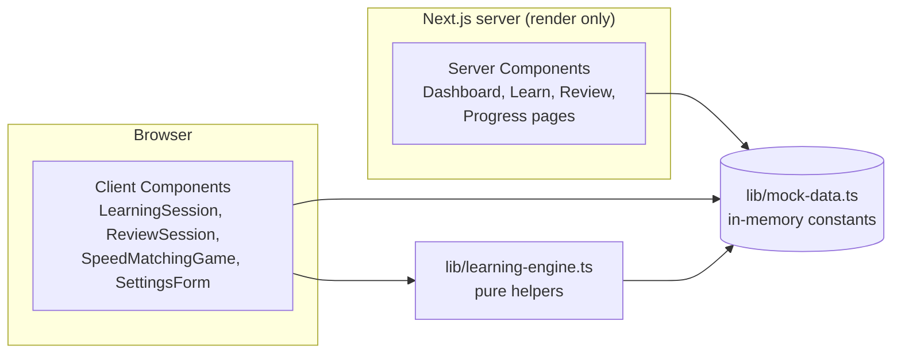
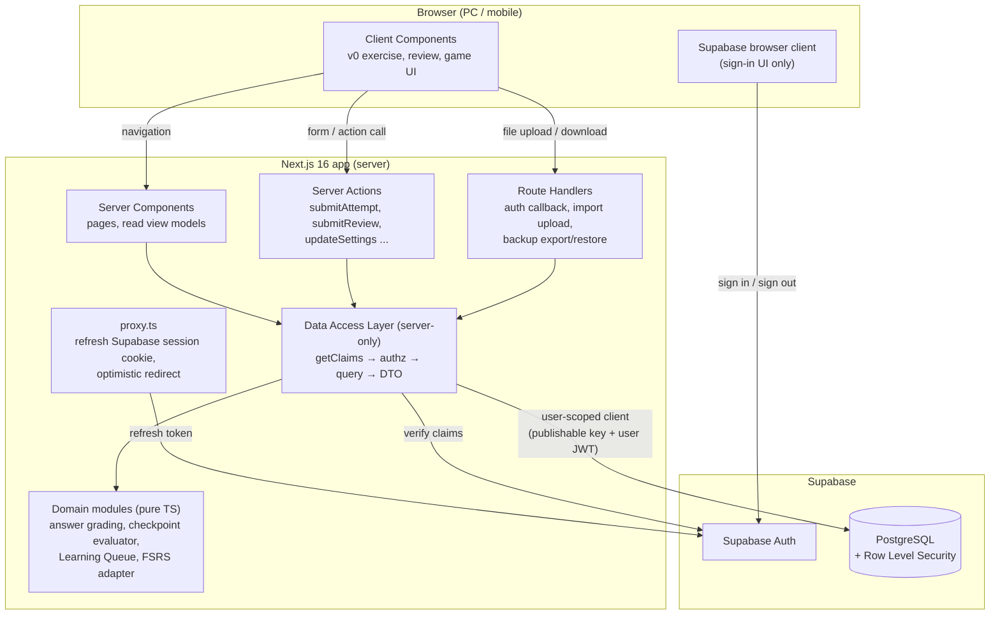
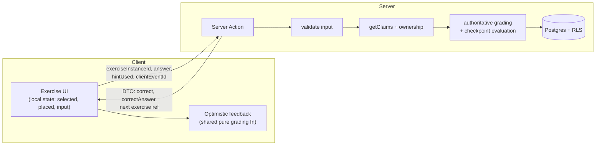
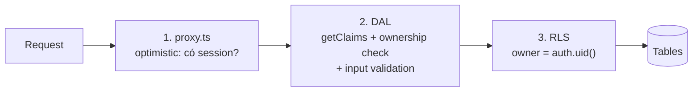
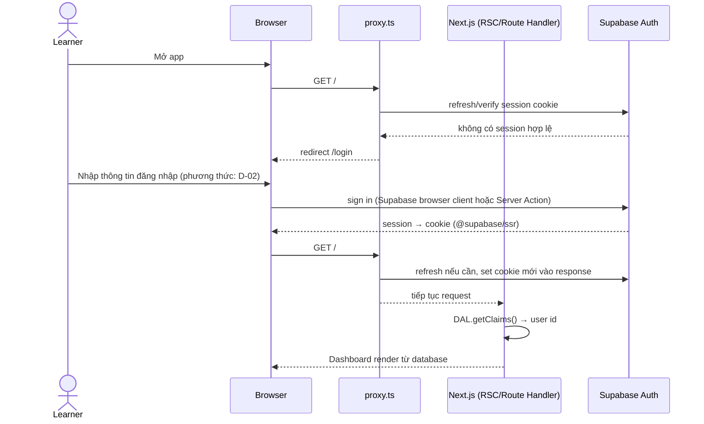
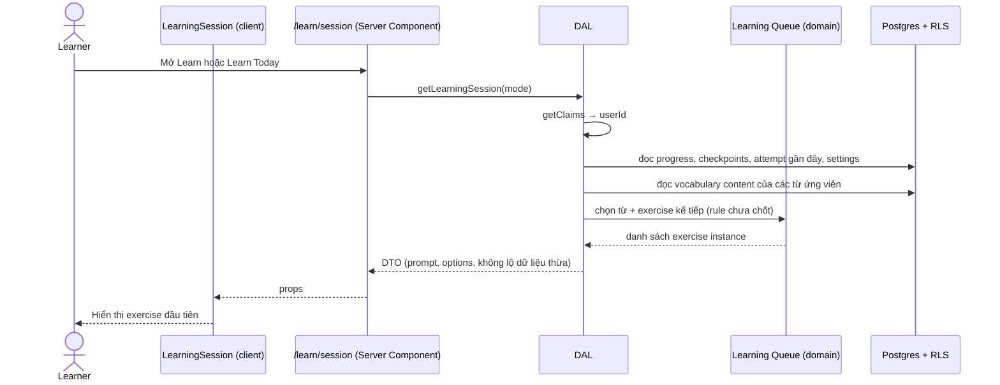
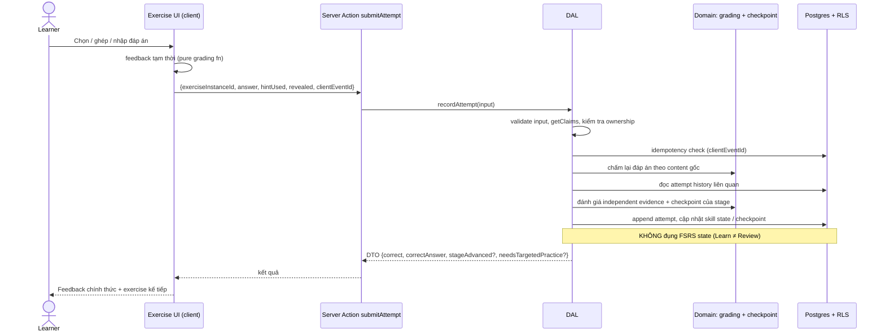
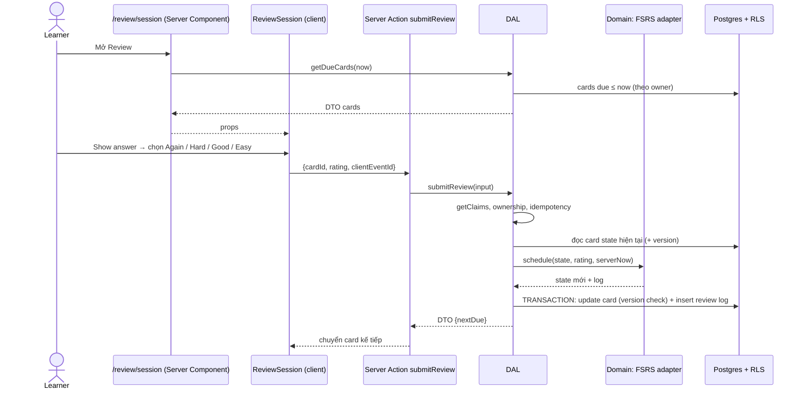
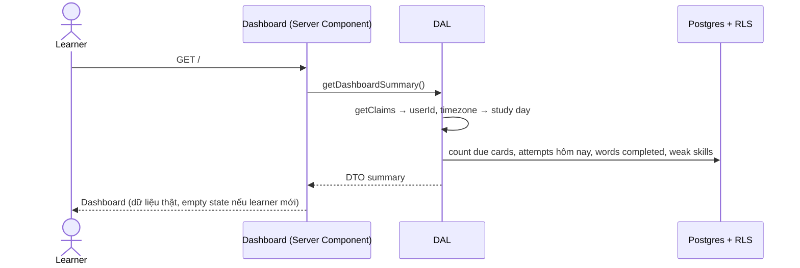

# ARCH-03 — Kiến trúc Projap

> Trạng thái: **Hoàn thành — chủ dự án xác nhận (2026-10-16)**. Learning flow trong tài liệu này viết theo V5; khi khác biệt, `docs/PROJECT_SPEC.md` (V6) được ưu tiên.
>
> Ngày: 2026-10-16
>
> Source tham chiếu: commit `afbd50d` (`chore: import original v0 UI`). Từ commit này đến nay không có file tracked nào thay đổi.
>
> Tài liệu liên quan: `docs/ui-audit.md` (ARCH-02), `docs/mvp-scope.md` (PLAN-01), `docs/ux-flow-audit.md` (UX-01)

## 0. Cách đọc tài liệu

Tài liệu dùng ba nhãn để không nhầm giữa thứ đã có và thứ mới chỉ dự kiến:

| Nhãn | Ý nghĩa |
| --- | --- |
| **Implemented** | Đã có trong source và đã kiểm tra trực tiếp |
| **Decided** | Chủ dự án đã chốt nhưng **chưa có code** |
| **Proposed** | Claude đề xuất trong ARCH-03, **cần chủ dự án duyệt** trước khi coi là quyết định |

Tài liệu này **không** định nghĩa database schema chi tiết, Learning Queue scheduling hay FSRS Card Taxonomy. Ba phần đó vẫn chưa được chốt (xem mục 10).

---

## 1. Architecture Overview

### 1.1 Hiện trạng (Implemented)

Projap hiện là **frontend prototype độc lập** do v0 sinh ra:

- Next.js App Router render page. Dữ liệu import thẳng từ `lib/mock-data.ts`.
- Mọi tương tác (learning session, review, Speed Matching, settings) chỉ sống trong React state phía client.
- Không có backend, database, authentication, FSRS hay persistence. Refresh trình duyệt là mất toàn bộ kết quả.

Chi tiết xem `docs/ui-audit.md`, mục 2 và mục 9.

### 1.2 Kiến trúc mục tiêu (Decided + Proposed)

Mục tiêu là **một ứng dụng Next.js full-stack duy nhất**, dùng Supabase làm dịch vụ Auth và PostgreSQL:

- **Decided:** Next.js là cả UI lẫn backend (Backend-for-Frontend), không có service backend riêng.
- **Decided:** Supabase Auth quản lý danh tính, Supabase PostgreSQL lưu dữ liệu.
- **Proposed:** Mọi truy cập dữ liệu đi qua một **Data Access Layer (DAL)** chỉ chạy trên server.
- **Proposed:** RLS là lớp bảo vệ thứ hai ở database. DAL không phải hàng rào duy nhất.
- **Proposed:** Logic học (đánh giá đáp án, checkpoint, FSRS) là **pure TypeScript domain module**, không I/O, test được độc lập.
- **Proposed:** Server là nguồn sự thật (server-authoritative) cho learning progress và FSRS state. Client chỉ hiển thị và gửi sự kiện.

Nguyên tắc xuyên suốt:

1. **Giữ UI v0.** Thay data source và callback ở boundary, không viết lại component (đúng khuyến nghị ARCH-02, mục 10).
2. **Tách Learn / Practice / Official Review.** Chỉ Official Review được thay đổi FSRS scheduling state.
3. **Một learner, nhiều thiết bị.** Đồng bộ bằng cách cùng đọc/ghi một database. **Không** làm offline-first.

---

## 2. Technology Stack

| Lớp | Công nghệ | Trạng thái | Ghi chú |
| --- | --- | --- | --- |
| Framework | Next.js **16.4.0**, App Router | Implemented | Next 16 có breaking changes. Đọc `node_modules/next/dist/docs/` trước khi code (theo `AGENTS.md`) |
| UI runtime | React 19 | Implemented | Có dùng `useEffectEvent` |
| Ngôn ngữ | TypeScript 5.7.3, `strict` | Implemented | `next.config.mjs` đang có `ignoreBuildErrors: true`, xem rủi ro ở mục 10 |
| Styling | Tailwind CSS 4.3 + `tw-animate-css` | Implemented | Dark theme token trong `app/globals.css` |
| UI primitives | Base UI, shadcn config, Lucide | Implemented | |
| Package manager | pnpm 12.3.4 | Implemented | `packageManager` trong `package.json` |
| Analytics | `@vercel/analytics` (chỉ bật ở production) | Implemented | Có giữ hay không phụ thuộc vào hosting, xem mục 10 |
| Auth | Supabase Auth | Decided | Chưa có dependency |
| Database | Supabase PostgreSQL | Decided | Chưa có project và schema |
| Supabase client | `@supabase/supabase-js` + `@supabase/ssr` | Proposed | `@supabase/ssr` là package Supabase khuyến nghị cho cookie-based session trong Next.js |
| Server-only guard | `server-only` | Proposed | Build lỗi nếu module DAL bị import vào Client Component |
| FSRS | Một FSRS implementation cho TypeScript (ứng viên: `ts-fsrs`) | Proposed | **Chưa chọn.** Thư viện, version và parameter là Open Decision |
| Validation | Một schema validator cho input Server Action và file import (ví dụ Zod) | Proposed | Chưa chọn |
| Testing | Unit test cho domain module, integration test cho DAL/RLS | Proposed | Hiện chưa có test runner |
| Hosting | Chưa chốt | Open | Xem mục 10 |

Ràng buộc: không chuyển sang PHP, Firebase hay MongoDB (xem mục 9).

---

## 3. Architecture Diagram

### 3.1 Hiện trạng (Implemented)

Không có HTTP boundary, database hay auth. State chỉ nằm trong component.

### 3.2 Mục tiêu (Decided + Proposed)

Ghi chú:

- `proxy.ts` là tên mới của Middleware từ Next.js 16. Next.js khuyến cáo chỉ dùng Proxy cho optimistic check, **không** dùng làm cơ chế authorization chính.
- DAL dùng **user-scoped Supabase client**, nên RLS luôn có hiệu lực. Secret/service-role key không được dùng ở request path thông thường (xem mục 5).

---

## 4. Client / Server Responsibilities

### 4.1 Vai trò từng thành phần

| Thành phần | Chạy ở đâu | Trách nhiệm | Không được làm |
| --- | --- | --- | --- |
| **Client Components** (`'use client'`) | Browser (cũng prerender trên server) | Tương tác: chọn đáp án, flip card, assembly, timer, keyboard shortcut. Hiển thị feedback ngay. Gọi Server Action | Truy cập database, đọc secret, tự quyết định FSRS state, tự đánh dấu checkpoint đạt |
| **Server Components** | Server | Đọc dữ liệu qua DAL, dựng view model, truyền **DTO tối thiểu** xuống Client Component | Mutation, ghi cookie, truyền nguyên database row xuống client |
| **Server Actions** (`'use server'`) | Server, gọi qua POST | Mutation từ UI: ghi attempt, submit review rating, cập nhật settings, đánh dấu introduction đã xem | Tin `user_id` hay correctness do client gửi. Bỏ qua kiểm tra auth bên trong action |
| **Route Handlers** (`route.ts`) | Server | Endpoint không hợp với Server Action: auth callback/confirm, upload CSV/JSON, download backup file, restore | Trở thành API public tùy tiện. Mỗi handler phải kiểm tra auth giống DAL |
| **Proxy** (`proxy.ts`) | Server, trước mỗi request khớp `matcher` | Refresh Supabase session cookie. Optimistic redirect người chưa đăng nhập về `/login` | Là lớp authorization duy nhất. Fetch dữ liệu chậm |
| **Data Access Layer** | Server only (`import 'server-only'`) | Xác thực (`getClaims`), authorization, query, trả DTO. Gọi domain module | Bị import từ Client Component |
| **Domain modules** | Thuần TS, chạy ở đâu cũng được | Grading, checkpoint evaluation, Learning Queue, FSRS adapter. Không I/O | Gọi database hay đọc `process.env` |
| **Supabase Auth** | Supabase | Danh tính, phát và refresh JWT, quản lý session | Thay thế authorization theo resource |
| **PostgreSQL** | Supabase | Nguồn sự thật cho content, progress, FSRS state, review history | Chứa logic học phức tạp. Logic nằm ở domain module, trừ transaction/RPC cần atomic (mục 6.4) |
| **RLS** | PostgreSQL | Lớp bảo vệ thứ hai: mỗi row user-owned chỉ đọc/ghi được bởi `auth.uid()` chủ sở hữu | Bị tắt trên bảng user-owned |

### 4.2 Ranh giới Client / Server (Proposed)

Quy tắc đề xuất:

1. **Client gửi sự kiện, không gửi kết luận.** Payload là "học viên trả lời X cho exercise instance Y" (kèm `hintUsed`, `revealed`, `clientEventId`), không phải "mark correct" hay "set stability = 4.2".
2. **Server chấm lại.** Client vẫn có thể hiển thị feedback ngay bằng cùng hàm pure grading (đang có `isRecallCorrect`, `normalizeAnswer`), nhưng giá trị server tính mới được lưu.
3. **Checkpoint evaluation chạy trên server.** "Independent evidence" (không hint, không reveal, không submit lặp ngay, cách nhau bởi câu khác) phải được đánh giá từ attempt history đã lưu, không từ index của component.
4. **FSRS chỉ chạy trên server** và chỉ trong Official Review. Thời điểm review do server quyết định.
5. **Mỗi mutation có idempotency key** (`clientEventId`). Gửi lặp không tạo hai attempt hay reschedule hai lần.
6. **Server Component chỉ truyền DTO.** Ví dụ, exercise không gửi kèm đáp án đúng nếu exercise đó cần chấm ở server. Đây là đánh đổi với feedback tức thì, xem Open Decision D-07.

---

## 5. Authentication & Security

### 5.1 Mô hình danh tính

- **Decided:** Supabase Auth.
- **Proposed:** Ứng dụng phục vụ **đúng một learner account**:
  - Tắt public sign-up trong Supabase Auth settings. Tạo user thủ công hoặc qua invite.
  - Phương thức đăng nhập (email/password, magic link/OTP hay OAuth) là Open Decision D-02.
- **Proposed:** Mọi bảng user-owned có cột owner tham chiếu `auth.users`. RLS policy so khớp với `auth.uid()`. Có chỗ cho nhiều user về sau mà không đổi kiến trúc.

### 5.2 Quản lý session (Proposed)

Theo hướng dẫn hiện hành của Supabase cho Next.js:

| Việc | Cách làm |
| --- | --- |
| Lưu session | Cookie do `@supabase/ssr` quản lý (không dùng `localStorage`) |
| Refresh token | `proxy.ts` tạo Supabase server client, refresh session và **trả về đúng response object chứa cookie mới**. Server Components không ghi được cookie, nên việc refresh phải nằm ở Proxy |
| Kiểm tra đăng nhập ở server | `supabase.auth.getClaims()` trong DAL. **Không** dùng `getSession()` để ra quyết định authorization ở server, vì nó chỉ đọc cookie mà không xác minh |
| Cần user record mới nhất | `getUser()` (có network call tới Auth server) chỉ khi thật sự cần |
| Bảo vệ route | Proxy redirect optimistic. Page/layout gọi DAL. **Mỗi Server Action và Route Handler tự kiểm tra lại** |
| Sign out | Server Action hoặc Route Handler (POST), không phải side effect khi render |
| Caching | Page có dữ liệu cá nhân phải dynamic. Không để CDN hay ISR cache response mang cookie session |

Lưu ý: tên biến môi trường và loại key (publishable key so với anon key cũ) phải được kiểm tra lại theo Supabase dashboard ở thời điểm triển khai AUTH-01.

### 5.3 Bảo vệ dữ liệu: defense in depth (Proposed)

| Lớp | Chặn được gì | Không thay thế được |
| --- | --- | --- |
| Proxy | Người chưa đăng nhập thấy UI riêng tư | Authorization. Có thể bị bypass bằng direct POST tới Server Action |
| DAL | IDOR, input sai, field nhạy cảm lọt ra DTO | Lỗi lập trình quên gọi DAL |
| RLS | Truy cập chéo user kể cả khi code server có bug | Validation nghiệp vụ |

### 5.4 Quy tắc secret và key (Proposed)

- Chỉ Supabase URL và **publishable/anon key** được có prefix `NEXT_PUBLIC_`. Key này an toàn ở client **chỉ khi RLS bật đúng**.
- **Secret/service-role key** bỏ qua RLS:
  - Không đặt prefix `NEXT_PUBLIC_`, không import từ Client Component, không dùng ở request path thông thường.
  - Nếu cần (seed content, migration, script admin), dùng ở script local hoặc CI tách khỏi app runtime.
- `.env*` đã nằm trong `.gitignore` (Implemented). Dự kiến thêm `.env.example` không chứa giá trị thật.
- Chỉ DAL và module config server được đọc `process.env`.

### 5.5 Các rủi ro bảo mật khác cần xử lý ở task sau

- Server Action có thể bị gọi bằng direct POST: kiểm tra auth bên trong từng action.
- Validate kích thước và định dạng file import/restore. Xử lý file như dữ liệu không tin cậy.
- Backup file chứa dữ liệu học cá nhân. Cần quyết định có mã hóa hay không (Open Decision trong `mvp-scope.md`, câu 21).
- `@vercel/analytics` gửi dữ liệu page view ra bên ngoài. Cần xác nhận còn phù hợp với app cá nhân và hosting đã chọn.

---

## 6. Database & Data Access

> Mục này chỉ mô tả **nhóm dữ liệu và quy tắc truy cập**. Tên bảng, cột và quan hệ chi tiết thuộc task DB-01, sau khi Learning Queue và FSRS Card Taxonomy đã chốt.

### 6.1 Nhóm dữ liệu khái niệm (Proposed)

| Nhóm | Nội dung | Owner | Ghi chú |
| --- | --- | --- | --- |
| **Content** | Vocabulary item: Kanji form nếu có, Hiragana, Romaji, nghĩa tiếng Việt, Hán Việt của cả từ, JLPT level, cờ kana-only, stable external ID cho import | Shared (đọc), ghi qua import | Hán Việt bắt buộc với từ có Kanji. **Không** tách Hán Việt từng chữ thành đơn vị học trong MVP |
| **Learner profile & settings** | Daily quota, timezone/study-day boundary, hiển thị romaji, các toggle | User-owned | Thay cho state cục bộ của `SettingsForm` |
| **Learning progress** | Stage hiện tại của mỗi từ. Checkpoint đã đạt (lưu **tách khỏi** hiệu suất hiện tại). Trạng thái từng skill S1–S4 | User-owned | Không reset toàn bộ khi sai một câu |
| **Attempt history** | Append-only: exercise type, skill, đúng/sai, hint/reveal, thời điểm, session, idempotency key | User-owned | Nguồn để đánh giá "independent evidence" |
| **FSRS cards** | Scheduling state cho mỗi card (due, stability, difficulty, …) | User-owned | **Số card mỗi từ chưa chốt** (FSRS Card Taxonomy) |
| **Review log** | Append-only: rating Again/Hard/Good/Easy, state trước/sau, thời điểm, FSRS version/parameters | User-owned | Chỉ Official Review ghi |
| **Practice results** | Kết quả mini-game | User-owned | **Không** reschedule FSRS |
| **Import jobs** | Lịch sử import CSV/JSON, số dòng accepted/rejected | User-owned | Duplicate policy chưa chốt |
| **Session records** | Learn Today session, summary | User-owned | Phụ thuộc Daily Session Planner (chưa thiết kế) |

### 6.2 Quy tắc truy cập dữ liệu (Proposed)

1. **Chỉ một cách truy cập:** Server Component, Server Action và Route Handler → DAL → Supabase. Không query Supabase rải rác trong component (ARCH-02, mục 12).
2. **DAL trả DTO**, không trả raw row.
3. **RLS bật trên mọi bảng user-owned** với policy theo `auth.uid()`. Bảng content: authenticated user chỉ đọc, ghi qua đường import được kiểm soát.
4. **Thời gian:** lưu `timestamptz` (UTC). "Ngày học" tính theo timezone của learner, lấy từ settings. Mặc định đề xuất `Asia/Ho_Chi_Minh`, xem Open Decision D-05.
5. **Migration** quản lý bằng Supabase CLI migrations trong repo, review như code. Không sửa schema bằng tay trên dashboard production.

### 6.3 Read model cho UI

| Màn hình | Nguồn mới (thay mock) |
| --- | --- |
| Dashboard | Aggregate query: due now, tiến độ quota hôm nay, số từ đã hoàn thành initial learning, weak skills |
| Library | Content + learning state của learner |
| Learn / Learn Today | Learning Queue (domain) + progress |
| Review | FSRS due queue |
| Progress | Attempt history và review log tổng hợp |

### 6.4 Tính atomic và idempotency (Proposed)

- **Submit review** phải ghi card state mới và review log trong **một transaction**: Postgres function gọi qua RPC, hoặc transaction ở server. Cách nào là Open Decision D-04.
- Chống ghi đè do hai thiết bị: optimistic concurrency theo version hoặc thời điểm review cuối của card. Event cũ bị từ chối, không âm thầm ghi đè.
- Idempotency: unique constraint trên `(owner, client_event_id)` cho attempt và review.

---

## 7. End-to-End Data Flow (Proposed)

Mọi luồng dưới đây là **thiết kế mục tiêu, chưa có code**.

### 7.1 Đăng nhập

### 7.2 Mở phiên học từ vựng và lấy nội dung

### 7.3 Trả lời bài tập, server xử lý và lưu learning progress

Khi một từ đạt checkpoint Stage 5, nó được đánh dấu **eligible for FSRS Review**. Việc này tạo FSRS card như thế nào phụ thuộc FSRS Card Taxonomy (chưa chốt).

### 7.4 Flashcard Review: ghi review history và cập nhật FSRS

### 7.5 Dashboard hiển thị tiến độ từ database

Sau mỗi mutation, Server Action revalidate path hoặc data liên quan để Dashboard và Review phản ánh dữ liệu mới, trên cùng thiết bị và ở lần tải kế tiếp trên thiết bị khác.

---

## 8. Architecture Decision Record (ADR)

| ID | Quyết định | Trạng thái |
| --- | --- | --- |
| ADR-001 | Một Next.js App Router full-stack app, không tách backend riêng | **Accepted** (chủ dự án chốt) |
| ADR-002 | Supabase PostgreSQL + Supabase Auth | **Accepted** (chủ dự án chốt) |
| ADR-003 | Cookie-based session qua `@supabase/ssr`, refresh trong `proxy.ts`, authorization bằng `getClaims()` trong DAL | **Proposed** |
| ADR-004 | Data Access Layer `server-only` + RLS bật trên mọi bảng user-owned (defense in depth) | **Proposed** |
| ADR-005 | Server Actions cho mutation từ UI; Route Handlers cho auth callback, file import/export, backup/restore | **Proposed** |
| ADR-006 | Server-authoritative grading, checkpoint evaluation và FSRS scheduling; client gửi event có idempotency key | **Proposed** |
| ADR-007 | Learning logic là pure domain modules (không I/O), có unit test | **Proposed** |
| ADR-008 | Chỉ Official Review cập nhật FSRS; Learn/Practice chỉ ghi attempt/practice result | **Accepted** (theo handoff đã chốt) |

### ADR-001: Next.js full-stack, không backend riêng

- **Bối cảnh:** App cá nhân, một learner, UI v0 đã viết bằng Next.js.
- **Quyết định:** Dùng Server Components, Server Actions và Route Handlers làm backend.
- **Hệ quả (+):** Một codebase, một ngôn ngữ, type dùng chung giữa UI và server, deploy đơn giản.
- **Hệ quả (−):** Logic server gắn với runtime Next.js. Cần kỷ luật DAL để không lẫn data access vào UI.

### ADR-002: Supabase PostgreSQL + Auth

- **Bối cảnh:** Cần đăng nhập, đồng bộ đa thiết bị, dữ liệu quan hệ (content ↔ progress ↔ card ↔ log), transaction cho review.
- **Quyết định:** Supabase managed Postgres + Supabase Auth.
- **Hệ quả (+):** Relational integrity, transaction, RLS gắn với danh tính Auth, không phải tự vận hành DB/Auth.
- **Hệ quả (−):** Phụ thuộc nhà cung cấp. Cần quản lý migration và RLS policy cẩn thận. RLS sai là lỗ hổng.

### ADR-003 đến ADR-007

Lý do và hệ quả được trình bày ở mục 4 đến mục 6. Các ADR này cần chủ dự án duyệt. Khi được duyệt, đề xuất tách thành file riêng `docs/adr/ADR-00X-*.md`.

---

## 9. Rejected Alternatives

| Phương án | Lý do không chọn |
| --- | --- |
| **PHP API + MariaDB** | Thêm một backend và một ngôn ngữ thứ hai bên cạnh Next.js. Phải tự viết auth, session, CORS và API contract. Mất lợi thế type dùng chung với UI v0 TypeScript. MariaDB không có cơ chế tương đương RLS gắn với identity provider. Tăng chi phí vận hành cho một app một người dùng |
| **Firebase (Firestore + Firebase Auth)** | Firestore là document store: quan hệ content ↔ progress ↔ FSRS card ↔ review log và aggregate cho Dashboard khó và tốn read hơn. Transaction có giới hạn hơn SQL. Security Rules là một DSL riêng, khác với policy SQL. Lock-in vào data model phi quan hệ |
| **MongoDB** | Dữ liệu học có cấu trúc quan hệ rõ, cần ràng buộc unique (idempotency, duplicate import) và join cho thống kê. MongoDB không kèm Auth, không có RLS. Phải tự ghép auth provider và tầng authorization |

Các phương án này **chỉ được xem xét lại** nếu chủ dự án yêu cầu architecture reconsideration.

---

## 10. Implementation Roadmap & Open Decisions

### 10.1 Roadmap đề xuất (Proposed: thứ tự, chưa phải cam kết)

Mỗi task vẫn theo quy trình: inspect → plan → **chờ duyệt** → implement.

| # | Task | Mục tiêu | Phụ thuộc |
| --- | --- | --- | --- |
| 1 | **GIT-03** | Đưa `docs/` (ui-audit, mvp-scope, architecture, ux-flow-audit) + `CLAUDE.md` vào branch docs, mở PR, review, merge | — |
| 2 | **SPEC-01** Learning Flow V5 spec | Ghi V5 (S1–S4, 5 stage, checkpoint) thành `docs/specs/` để code tham chiếu | — |
| 3 | **SPEC-02** Learning Queue | Chốt scheduling, interleave, retry rule, threshold config | SPEC-01 |
| 4 | **SPEC-03** FSRS Card Taxonomy | Chốt số loại card mỗi từ, thư viện FSRS, parameters | SPEC-01 |
| 5 | **QA-01** Quality baseline | Script `typecheck`/`lint`/`test`. Kế hoạch bỏ `ignoreBuildErrors` | — |
| 6 | **DB-01** Schema + RLS | Migration đầu tiên theo SPEC-01..03, RLS policy, test RLS | SPEC-02, SPEC-03 |
| 7 | **AUTH-01** Supabase Auth | `@supabase/ssr`, `proxy.ts`, trang login, DAL `getCurrentUser` | DB-01 (hoặc song song) |
| 8 | **DATA-01** Content seed/import | Seed N5 nhỏ, schema import CSV/JSON | DB-01 |
| 9 | **LEARN-01** Vertical slice | Learning session đọc/ghi thật, server grading, checkpoint | SPEC-01..02, DB-01, AUTH-01 |
| 10 | **REVIEW-01** Official Review | FSRS adapter, due queue, transaction, idempotency | SPEC-03, LEARN-01 |
| 11 | **DASH-01** Dashboard/Progress thật | Thay mock bằng aggregate | LEARN-01, REVIEW-01 |
| 12 | **TODAY-01** Learn Today + Daily Session Planner | Thiết kế riêng rồi triển khai | SPEC-02, REVIEW-01 |
| 13 | **BACKUP-01** Backup/restore | Export/restore versioned, atomic | DB-01 |
| 14 | **LIB-01** Library detail | Chi tiết từ, nút "Học từ này" đưa vào queue (UXI-10, UXI-18) | LEARN-01 |
| 15 | **SETTINGS-01** Settings thật | Lưu settings, gắn vào tính năng (UXI-11) | DB-01, AUTH-01 |
| 16 | **PRACTICE-01** Practice | Gắn game với từ đã học, ghi practice result, xử lý placeholder (UXI-12, UXI-13, UXI-15) | LEARN-01 |

Các mã `UXI-xx` (UX issue) và `FG-xx` (future gap) tham chiếu `docs/ux-flow-audit.md`.

### 10.2 Open Decisions

| ID | Câu hỏi | Ghi chú |
| --- | --- | --- |
| D-01 | Hosting/deployment (Vercel hay nền tảng khác), region | Ảnh hưởng `@vercel/analytics`, env management |
| D-02 | Phương thức đăng nhập: email/password, magic link/OTP hay OAuth | Một account, tắt public sign-up |
| D-03 | Thư viện FSRS, version, parameter mặc định | Ứng viên `ts-fsrs`; gắn với SPEC-03 |
| D-04 | Atomic review: Postgres function (RPC) hay transaction ở server | Cả hai đều server-authoritative |
| D-05 | Timezone và ranh giới "ngày học" | Đề xuất mặc định `Asia/Ho_Chi_Minh` |
| D-06 | Session resume: refresh giữa chừng thì tiếp tục đúng exercise hay tạo session mới từ progress đã lưu | `mvp-scope.md` câu 13 |
| D-07 | Mức độ server grading: gửi đáp án xuống client để feedback tức thì (đơn giản, rủi ro thấp với app một người) hay chấm hoàn toàn ở server | Ảnh hưởng latency feedback |
| D-08 | Môi trường: local/preview/production dùng Supabase project riêng hay chung | |
| D-09 | Giữ hay bỏ `@vercel/analytics` | Quyền riêng tư dữ liệu học |
| D-10 | Mode Kanji riêng (`/learn/session?mode=kanji`) giữ, ẩn hay hoãn | Mâu thuẫn với V5, xem 10.3 |
| D-11 | Learning Queue scheduling | **Chưa chốt theo handoff.** Không tự đặt rule |
| D-12 | FSRS Card Taxonomy | **Chưa chốt theo handoff.** Không tạo card thừa |
| D-13 | Ngôn ngữ giao diện (copy UI hiện bằng tiếng Anh, người học dùng tiếng Việt) | Ảnh hưởng `lang` của `<html>` và copy. Xem UXI-17 |

### 10.3 Mâu thuẫn với tài liệu cũ (chỉ báo cáo, chưa sửa tài liệu)

| Tài liệu | Nội dung cũ | Hiện trạng đã chốt |
| --- | --- | --- |
| `docs/mvp-scope.md` mục 9, câu 1–3 | Data/auth platform và server boundary còn để mở | Stack Supabase + Next.js đã chốt (ADR-001/002). Server boundary được đề xuất ở ADR-005 |
| `docs/mvp-scope.md` mục 2 (yêu cầu 3, 4), P0-3, P0-5 | Vocabulary và Kanji là hai luồng học ngang nhau. Kanji có readings riêng | V5: Vocabulary là đơn vị chính. Kanji và Hán Việt học **theo cả từ**. Không tách Hán Việt từng chữ trong MVP |
| `docs/mvp-scope.md` mục 7 | Flow `Flashcard → Recognition → Assembly → Recall` | V5 có 5 stage, checkpoint nhiều lượt, interleave |
| `docs/mvp-scope.md` P0-7 | "Vocabulary và Kanji đều có thể tạo review card" | FSRS Card Taxonomy **chưa chốt**. Không tạo card thừa |
| `docs/mvp-scope.md` câu 14 | Practice không reschedule FSRS vẫn chờ xác nhận | Đã chốt (ADR-008) |
| `docs/mvp-scope.md` | Không có Learn Today / Daily Session Planner | Learn Today đã được xác nhận là trải nghiệm học chính bên cạnh Learn/Review/Practice |
| `docs/ui-audit.md` mục 5.1 | Mô tả flow 7 stage và Kanji flow như phần có thể tái sử dụng | Component tái sử dụng được, nhưng **thứ tự stage hiện tại không khớp V5** (chi tiết trong `docs/ux-flow-audit.md`, mục 7) |

### 10.4 Rủi ro kỹ thuật

- `next.config.mjs`: `typescript.ignoreBuildErrors: true`, nên build production có thể che lỗi type.
- Chưa có test runner, lint hay typecheck script.
- Next.js 16 đổi một số convention (ví dụ `middleware` → `proxy`). Tài liệu bên thứ ba cũ có thể sai.
- RLS sai cấu hình là lỗ hổng nghiêm trọng nhất khi publishable key ở client. Cần test RLS tự động.
- Chưa có `.env.example`. Cần quy ước biến môi trường trước AUTH-01.
