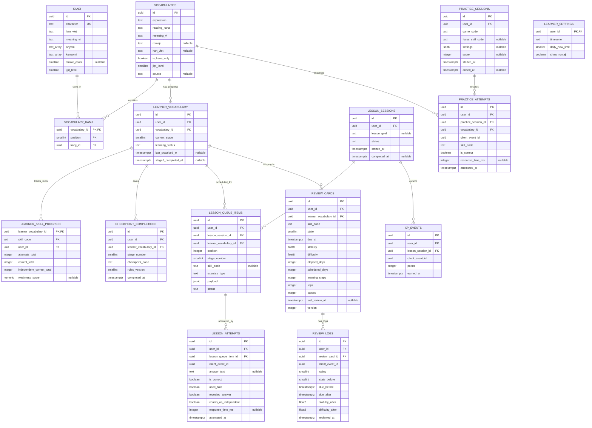

# DB-01 — Thiết kế dữ liệu cốt lõi

> Trạng thái: **Đã chốt — chủ dự án duyệt ngày 2026-10-23**. Các mục PROPOSED ở §1–§4 nay là **CONFIRMED**; các mục PENDING ở §7 vẫn để ngỏ.
>
> Ngày: 2026-10-23
>
> Gốc: ERD V6 (12 bảng, tài liệu "PROJAP V6 — Giải thích database"). Tài liệu này **giữ nguyên tinh thần V6** và bổ sung những gì cần để triển khai trên Supabase/PostgreSQL theo `docs/PROJECT_SPEC.md` và `docs/security.md` (SEC-01, đã chốt).
>
> Phạm vi: thiết kế. SQL thật viết ở DB-02 (migration).

Nhãn: **CONFIRMED** (đã chốt) · **PROPOSED** (DB-01 đề xuất, cần duyệt) · **PENDING** (chưa quyết định, schema để ngỏ).

---

## 0. Đọc nhanh cho người mới

Database là một bộ **bảng tính có luật**. Mỗi bảng giống một sheet Excel, mỗi dòng là một bản ghi.

- **PK (Primary Key — khóa chính):** cột định danh duy nhất một dòng, giống số CMND. Ở đây dùng `uuid`, một chuỗi ngẫu nhiên không trùng.
- **FK (Foreign Key — khóa ngoại):** cột trỏ sang dòng của bảng khác. Database **từ chối** FK trỏ tới dòng không tồn tại, nên dữ liệu không bị "mồ côi".
- **UNIQUE:** luật "không được có hai dòng giống nhau ở các cột này". Dùng để chống nhập trùng và chống bấm nút hai lần.
- **CHECK:** luật kiểm tra giá trị, vd. Stage chỉ từ 1 đến 5.
- **Index:** mục lục giúp tìm nhanh, giống mục lục cuối sách.

Database chia ba lớp:

```text
1. Nội dung (từ điển)      vocabularies, kanji, vocabulary_kanji
2. Tiến độ của bạn          learner_settings, learner_vocabulary, learner_skill_progress, checkpoint_completions
3. Nhật ký hoạt động        Daily Lessons · FSRS Review · Practice (mỗi loại có bảng riêng)
```

---

## 1. Thay đổi so với ERD V6

| # | Thay đổi | Lý do | Nhãn |
| --- | --- | --- | --- |
| 1 | Thêm `kanji`, `vocabulary_kanji` | V6 CONFIRMED: Kanji có meanings/Hán Việt/readings, một Kanji thuộc nhiều từ; cần cho Kanji Assembly và task KAN-01..04 | PROPOSED |
| 2 | Thêm `learner_settings` | Quota từ mới/ngày (SET-01), timezone (SRS-04) chưa có chỗ lưu | PROPOSED |
| 3 | Thêm `user_id` vào mọi bảng tiến độ/nhật ký | Điều kiện để RLS hoạt động (SEC-01 §7, SEC-D2 đã chốt) | CONFIRMED |
| 4 | Thêm `client_event_id` + UNIQUE vào `lesson_attempts`, `practice_attempts`, `review_logs`, `xp_events` | Bấm hai lần / mạng chập chờn không tạo bản ghi trùng (SRS-03, SEC-01 §7) | PROPOSED |
| 5 | Thêm `version` vào `review_cards` | Hai thiết bị ôn cùng lúc không ghi đè nhau | PROPOSED |
| 6 | Bổ sung trường FSRS vào `review_cards`, `review_logs` | Thư viện FSRS cần nhiều trường hơn ERD V6 | PROPOSED (xác minh ở SRS-01) |
| 7 | Thêm `is_kana_only` vào `vocabularies` | Không phải suy đoán từ `han_viet` rỗng; quyết định bỏ Stage 3–4 | PROPOSED |
| 8 | Thêm `stage_number` vào `lesson_queue_items`; `counts_as_independent` vào `lesson_attempts` | Checkpoint cần biết câu thuộc Stage nào và lượt nào được server tính là "đúng độc lập" | PROPOSED |
| 9 | Thêm `rules_version` vào `checkpoint_completions` | Threshold là cấu hình khởi đầu, sẽ còn chỉnh | PROPOSED |
| 10 | Đổi kiểu TypeScript sang kiểu PostgreSQL; thêm CHECK, UNIQUE, index, quy tắc xóa | ERD V6 chỉ có kiểu TS | PROPOSED |

Tổng: **15 bảng** (12 V6 + 3 mới).

---

## 2. Quy ước chung

| Mục | Quy ước | Nhãn |
| --- | --- | --- |
| ID | `uuid`, mặc định `gen_random_uuid()` | PROPOSED |
| Thời gian | `timestamptz` (lưu UTC), mặc định `now()`. Hiển thị theo timezone trong `learner_settings` | PROPOSED |
| Chủ dữ liệu | `user_id uuid not null default auth.uid()` → `auth.users(id)` | CONFIRMED (SEC-01) |
| Tên bảng/cột | `snake_case`, tiếng Anh | PROPOSED |
| Mã Skill | `meaning` (S1), `kana` (S2), `kanji` (S3), `han_viet` (S4) | PROPOSED |
| JLPT | `smallint` 1–5; `5` = N5 | PROPOSED |
| Trạng thái | `text` + `CHECK (... in (...))`, không dùng Postgres enum (dễ thêm giá trị bằng migration) | PROPOSED |
| RLS | Bật trên mọi bảng; policy theo `docs/security.md` §6 | CONFIRMED |

---

## 3. ERD



Ghi chú: mọi bảng có `user_id` đều trỏ tới `auth.users(id)`; để sơ đồ gọn, quan hệ này không vẽ. Các bảng còn có `created_at`/`updated_at` khi cần.

---

## 4. Chi tiết từng bảng

Chỉ liệt kê ràng buộc và lý do; cột đã có trong ERD ở §3.

### 4.1 Nội dung

**`vocabularies`** — từ điển, dùng chung, không có `user_id`.

| Ràng buộc | Ý nghĩa |
| --- | --- |
| `UNIQUE (expression, reading_kana)` | Khóa chống trùng khi import. `今日/きょう` và `今日/こんにち` là hai dòng khác nhau (PENDING — chốt ở DATA-01, OD-22) |
| `CHECK (jlpt_level between 1 and 5)` | |
| `CHECK (is_kana_only or han_viet is not null)` | Từ có Kanji bắt buộc có Hán Việt toàn từ |
| `CHECK (not is_kana_only or han_viet is null)` | Từ chỉ có Kana thì không có Hán Việt |

**`kanji`** — `UNIQUE (character)`, `CHECK (char_length(character) = 1)`. Lưu đủ On/Kun nhưng MVP chỉ *hiển thị* reading theo từ đã học (KAN-03).

**`vocabulary_kanji`** — `PK (vocabulary_id, position)`: chữ thứ mấy trong từ. Index trên `kanji_id` để tìm "những từ chứa 学". Từ chỉ có Kana không có dòng nào ở đây.

### 4.2 Tiến độ

**`learner_settings`** — một dòng mỗi user. Mặc định: `timezone = 'Asia/Ho_Chi_Minh'`, `daily_new_limit` PENDING (SET-01), `show_romaji = true`.

**`learner_vocabulary`** — trạng thái học một từ.

| Ràng buộc | Ý nghĩa |
| --- | --- |
| `UNIQUE (user_id, vocabulary_id)` | Mỗi từ chỉ có một sổ theo dõi |
| `CHECK (current_stage between 1 and 5)` | Chưa học = chưa có dòng |
| `CHECK (learning_status in ('learning','initial_complete'))` | `initial_complete` khi qua Stage 5 (không phải "thành thạo") |
| Index `(user_id, learning_status)` | Learning Queue tìm từ đang học |

**`learner_skill_progress`** — "phong độ" từng skill.

- `PK (learner_vocabulary_id, skill_code)`; `CHECK (skill_code in ('meaning','kana','kanji','han_viet'))`.
- `independent_correct_total` tách khỏi `correct_total` để thấy rõ phần đúng nhờ hint.
- Từ chỉ có Kana chỉ có 2 dòng (`meaning`, `kana`).
- Đây là **số liệu tổng hợp** để chọn câu nhanh; nguồn sự thật vẫn là `lesson_attempts`.

**`checkpoint_completions`** — "huy chương", không sửa, không xóa.

- `UNIQUE (learner_vocabulary_id, stage_number, checkpoint_code)`: không đạt cùng một checkpoint hai lần.
- `CHECK (stage_number between 1 and 5)`.
- Danh sách `checkpoint_code` (PROPOSED, chốt ở learning engine):

| Stage | `checkpoint_code` |
| --- | --- |
| 1 | `intro_viewed` |
| 2 | `kana_to_meaning`, `meaning_to_kana` (gồm ≥1 Hiragana Assembly) |
| 3 | `kanji_hanviet_intro_viewed` |
| 4 | `kanji`, `han_viet`, `reinforce_kana_meaning` |
| 5 | `recall_meaning`, `recall_kana`, `recall_han_viet`, `recall_kanji` |

Stage được coi là xong khi đủ mọi code bắt buộc của Stage đó (từ chỉ có Kana: không cần code Stage 3–4 và `recall_han_viet`, `recall_kanji`).

### 4.3 Daily Lessons

**`lesson_sessions`** — `CHECK (status in ('active','completed','abandoned'))`. Index `(user_id, started_at)`.

**`lesson_queue_items`** — câu hỏi được giao.

- `UNIQUE (lesson_session_id, position)`.
- `CHECK (status in ('pending','answered','skipped'))`.
- `exercise_type` (PROPOSED): `intro`, `choice`, `assembly`, `flashcard_recall`, `free_recall`.
- `payload` chứa đề bài **và** đáp án để server chấm; DAL chỉ gửi phần đề bài xuống trình duyệt.

**`lesson_attempts`** — mỗi lần trả lời; **chỉ thêm, không sửa**.

- `UNIQUE (user_id, client_event_id)`: bấm "Kiểm tra" hai lần chỉ lưu một dòng.
- `counts_as_independent` do **server** tính: đúng, không hint, không xem đáp án, đã xen kẽ đủ (quy tắc xen kẽ PENDING, OD-04).
- `answer_text` lưu câu trả lời để tra lại khi cần.

**`xp_events`** — `UNIQUE (user_id, client_event_id)`, `CHECK (points >= 0)`. Công thức XP PENDING.

### 4.4 FSRS Review

**`review_cards`** — trạng thái hiện tại của một thẻ.

| Ràng buộc | Ý nghĩa |
| --- | --- |
| `UNIQUE (learner_vocabulary_id, skill_code)` | Mỗi từ tối đa một thẻ cho mỗi skill. Schema cho phép 1–4 thẻ/từ; **số thẻ thật sự tạo ra vẫn PENDING** (OD-02) |
| `CHECK (state between 0 and 3)` | New, Learning, Review, Relearning |
| Index `(user_id, due_at)` | Lấy thẻ đến hạn nhanh (REV-01) |
| `version` | Tăng 1 mỗi lần ôn; cập nhật kèm điều kiện `where version = <giá trị đã đọc>` để thiết bị thứ hai không ghi đè |

Thẻ được tạo khi từ hoàn thành Stage 5 (theo V6; **cần xác nhận**, OD-06). Thẻ Kanji độc lập **chưa có trong schema**: chờ thiết kế module Kanji (OD-05); thêm sau bằng migration bổ sung, không phá bảng hiện có.

Các trường FSRS lấy theo kiểu `Card` của `ts-fsrs`; danh sách chính xác và cách đánh số `state`/`rating` **xác minh lại ở SRS-01** khi chọn version thư viện.

**`review_logs`** — nhật ký, chỉ thêm.

- `UNIQUE (user_id, client_event_id)`: bấm Good hai lần chỉ có một log.
- `CHECK (rating between 1 and 4)`: Again, Hard, Good, Easy (xác minh ở SRS-01).
- Ghi **trong cùng transaction** với cập nhật `review_cards`.

### 4.5 Practice

**`practice_sessions`** — `game_code` (PROPOSED): `speed_matching`, `vocab_matching`, `kana_assembly`, `kanji_assembly`, `han_viet_assembly`, `recall_challenge`.

**`practice_attempts`** — `UNIQUE (user_id, client_event_id)`. Trỏ thẳng tới `vocabularies`, **không có đường nối nào tới `review_cards`**, nên game không thể làm đổi lịch ôn.

---

## 5. Quy tắc khi xóa (ON DELETE)

App không mở quyền xóa (SEC-D5). Quy tắc dưới đây chỉ áp dụng khi xóa bằng script/quản trị.

| Quan hệ | Quy tắc | Lý do |
| --- | --- | --- |
| `auth.users` → mọi bảng có `user_id` | `CASCADE` | Xóa tài khoản = xóa toàn bộ dữ liệu của tài khoản đó |
| `vocabularies` → `learner_vocabulary`, `practice_attempts` | `RESTRICT` | Không cho xóa từ khi đã có lịch sử học |
| `vocabularies` → `vocabulary_kanji` | `CASCADE` | Liên kết thuần nội dung |
| `kanji` → `vocabulary_kanji` | `RESTRICT` | Không xóa chữ đang được từ nào đó dùng |
| `learner_vocabulary` → skill progress, checkpoints, queue items, review cards | `CASCADE` | Dùng cho "reset tiến độ một từ" (qua DB function) |
| Session → queue items / attempts / XP; card → logs | `CASCADE` | Xóa cha thì con không còn ý nghĩa |

---

## 6. Ví dụ `学校` qua các bảng

```text
vocabularies
  id=V1  expression=学校  reading_kana=がっこう  meaning_vi=Trường học
         romaji=gakkō  han_viet=HỌC HIỆU  is_kana_only=false  jlpt_level=5

kanji
  id=K1  character=学  han_viet=HỌC
  id=K2  character=校  han_viet=HIỆU

vocabulary_kanji
  (V1, position=0, K1)
  (V1, position=1, K2)

learner_vocabulary
  id=LV1  vocabulary_id=V1  current_stage=4  learning_status=learning

learner_skill_progress
  (LV1, meaning)   attempts=6  correct=6  independent=5
  (LV1, kana)      attempts=7  correct=6  independent=4
  (LV1, kanji)     attempts=2  correct=1  independent=1
  (LV1, han_viet)  attempts=1  correct=0  independent=0

checkpoint_completions
  (LV1, stage 1, intro_viewed)
  (LV1, stage 2, kana_to_meaning)
  (LV1, stage 2, meaning_to_kana)
  (LV1, stage 3, kanji_hanviet_intro_viewed)

lesson_queue_items  (session S7)
  Q1  LV1  stage=4  skill=kanji  exercise=choice    status=answered
  Q2  LV1  stage=4  skill=kanji  exercise=assembly  status=answered

lesson_attempts
  Q1  correct  hint=no   → counts_as_independent=true
  Q2  wrong              → Q2 sẽ được xếp lại sau vài câu khác

review_cards        (chưa có — 学校 chưa qua Stage 5)
practice_attempts   (speed_matching, V1, meaning, correct)  — không chạm review_cards
```

Từ chỉ có Kana `これ`: `is_kana_only=true`, `han_viet=null`, không có dòng `vocabulary_kanji`, chỉ có skill `meaning` và `kana`, đi Stage 1 → 2 → 5.

---

## 7. Còn để ngỏ (không chặn DB-02)

| Vấn đề | Ảnh hưởng schema | Khi nào chốt |
| --- | --- | --- |
| Số thẻ FSRS mỗi từ (OD-02) | Không — schema cho phép 1–4 | SRS-01 |
| Thẻ tạo khi nào (OD-06) | Không | SRS-01 |
| Thẻ Kanji độc lập, flow Kanji (OD-05) | Thêm cột/bảng sau | KAN-01 |
| Khóa chống trùng khi import (OD-22) | UNIQUE trên `vocabularies` | DATA-01 |
| Romaji `gakkō` hay `gakkou` (OD-12) | Không | DATA-01 |
| Từ Katakana (OD-11) | Không | DATA-01 |
| Quy tắc xen kẽ, công thức `weakness_score`, XP | Không | SMART-01, SMART-02 |
| Lưu queue để tiếp tục đúng câu (OD-07) | Đã đủ: `lesson_queue_items.status` cho phép tiếp tục | LEARN/VOC |

---

## 8. Điều kiện nghiệm thu DB-01

- [x] ERD có PK, FK, UNIQUE, index (§3–4)
- [x] Ví dụ `学校` (§6) và từ chỉ có Kana
- [x] Mọi bảng tiến độ/nhật ký có `user_id` (khớp SEC-01)
- [x] Practice không có đường nối tới FSRS
- [x] Chủ dự án duyệt các mục PROPOSED ở §1–2 (2026-10-23)
