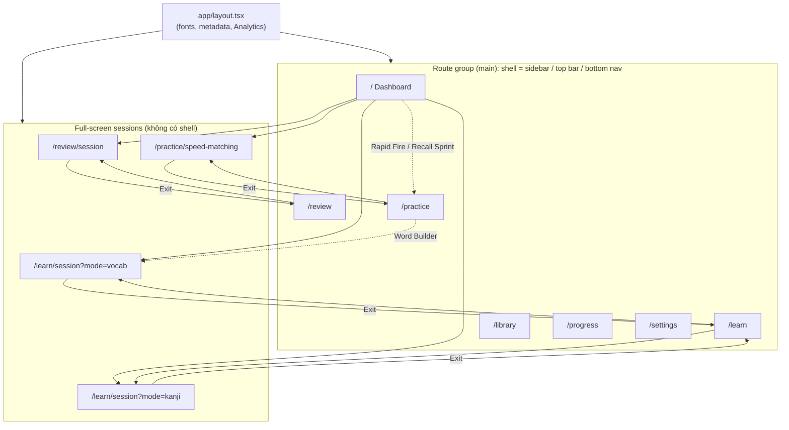

# UX-01 — Audit user flow hiện tại

> Trạng thái: **Hoàn thành — chủ dự án xác nhận (2026-10-16)**. Learning flow trong tài liệu này viết theo V5; khi khác biệt, `docs/PROJECT_SPEC.md` (V6) được ưu tiên.
>
> Ngày: 2026-10-16
>
> Source tham chiếu: commit `afbd50d`. Không có file tracked nào thay đổi kể từ commit này.
>
> Loại công việc: **Audit, không redesign.** Không đề xuất thay đổi visual language của v0.
>
> Tài liệu liên quan: `docs/ui-audit.md` (ARCH-02), `docs/architecture.md` (ARCH-03), `docs/mvp-scope.md` (PLAN-01)

## 0. Phương pháp và giới hạn kiểm thử

| Hạng mục | Cách đánh giá |
| --- | --- |
| Route, navigation, component, state, accessibility markup | **Đọc source trực tiếp** (`app/`, `components/`, `lib/`, `app/globals.css`) |
| Số thao tác để đến câu hỏi đầu tiên | **Suy ra từ source** (link `href`, nút, điều kiện render). Chưa đo trên trình duyệt |
| Responsive layout | **Chỉ đánh giá từ class Tailwind và breakpoint trong source.** Chưa render ở viewport thật |
| Runtime (render thực tế, overflow, animation, keyboard, screen reader) | **Chưa kiểm thử.** Phiên audit không chạy được `pnpm dev` trên máy chủ dự án và không mở được ứng dụng trong trình duyệt |

**Không có nhận định nào trong tài liệu này được coi là đã kiểm thử giao diện thực tế.** Những mục cần xác minh runtime được đánh dấu *(cần runtime check)*.

Quy ước trạng thái (thống nhất với ARCH-02):

| Nhãn | Ý nghĩa |
| --- | --- |
| **Works** | UI có và tương tác hoạt động thật (logic đúng), không phụ thuộc mock để có ý nghĩa |
| **Mock** | UI có, tương tác có thể chạy, nhưng dữ liệu là mock/hard-code, mất khi refresh |
| **Partial** | UI có nhưng tương tác chưa hoàn chỉnh hoặc gây hiểu nhầm |
| **Missing** | Chưa có UI |

---

## 1. UI Sitemap

Sitemap lập từ cấu trúc `app/`. Không có `loading.tsx`, `error.tsx`, `not-found.tsx` hay route Auth nào.

| Route | File | Loại | Trạng thái |
| --- | --- | --- | --- |
| `/` | `app/(main)/page.tsx` | Dashboard | Mock |
| `/learn` | `app/(main)/learn/page.tsx` | Overview | Mock |
| `/learn/session?mode=vocab` | `app/learn/session/page.tsx` | Session | Mock (2 từ cố định) |
| `/learn/session?mode=kanji` | `app/learn/session/page.tsx` | Session | Mock (3 Kanji cố định) |
| `/review` | `app/(main)/review/page.tsx` | Overview | Mock |
| `/review/session` | `app/review/session/page.tsx` | Session | Mock (8 card cố định) |
| `/practice` | `app/(main)/practice/page.tsx` | Catalog | Partial (2/4 game là placeholder) |
| `/practice/speed-matching` | `app/practice/speed-matching/page.tsx` | Game | Mock |
| `/library` | `app/(main)/library/page.tsx` | Browser | Mock (search/tab hoạt động) |
| `/progress` | `app/(main)/progress/page.tsx` | Stats | Mock |
| `/settings` | `app/(main)/settings/page.tsx` | Form | Partial (không lưu, không tác động) |
| Login / Sign out / Account | — | — | **Missing** |
| Learn Today | — | — | **Missing** |
| Import CSV/JSON | — | — | **Missing** |
| Backup / Restore | — | — | **Missing** |
| Vocabulary detail | — | — | **Missing** |

Mọi query `mode` khác `kanji` đều fallback về `vocab` (`app/learn/session/page.tsx`).

---

## 2. Existing User Journeys

Số thao tác dưới đây đếm **click/tap tính từ Dashboard đã hiển thị**, suy ra từ source *(cần runtime check)*.

### A. Dashboard → Learn → Vocabulary Session

| Bước | Thao tác | Nguồn |
| --- | --- | --- |
| 1 | Dashboard: card "New Vocabulary" → `/learn/session?mode=vocab` | `app/(main)/page.tsx:51-58` |
| 1′ | Hoặc: nav "Learn" → card "New Vocabulary" (2 thao tác) | `components/nav/nav-items.ts`, `app/(main)/learn/page.tsx:19-26` |
| 2 | Stage "Introduction": flashcard, bấm **Reveal** | `components/learning/steps/flashcard-exercise.tsx` |
| 3 | Bấm **Got it** → câu hỏi đầu tiên (Choice: "How is this word read?") | `lib/learning-engine.ts` (`kana-choice`) |
| … | 7 step/từ × 2 từ = 14 step, mỗi step chấm điểm cần Select/Build/Type → Check → Continue | `lib/learning-engine.ts:219-226` |
| End | Màn "Lesson complete!": Start Review / Back to Home / Do it again | `components/learning/learning-session.tsx:64-82` |

- **Đến câu hỏi đầu tiên:** 3 thao tác từ Dashboard (4 nếu đi qua nav Learn).
- **Nhận xét:**
  - Flow chạy được end-to-end nhưng tuyến tính: hết 7 step của từ 1 mới sang từ 2.
  - Trả lời sai vẫn sang bước tiếp theo.
  - Màn kết thúc ghi "They'll show up in tomorrow's review", nhưng không có gì được lưu.

### B. Dashboard → Library → Vocabulary → Learn

| Bước | Thao tác | Nguồn |
| --- | --- | --- |
| 1 | Desktop: sidebar "Library". Mobile: icon Library trên top bar | `components/nav/app-sidebar.tsx`, `mobile-top-bar.tsx` |
| 2 | Chọn tab Vocabulary/Kanji, gõ search | `components/library/library-browser.tsx` |
| 3 | **Không thể** mở chi tiết từ hay bấm "Học từ này". Card từ vựng không phải link hay button | `library-browser.tsx:70-84` |

- **Kết quả:** Journey **bị đứt** ở bước "Vocabulary → Learn". Muốn học phải quay sang Learn, và session vẫn chỉ dùng 2 từ cố định, không phải từ vừa chọn.
- Không có lối tắt nào từ Dashboard tới Library ngoài navigation.

### C. Dashboard → Review → Flashcard Session → Summary

| Bước | Thao tác | Nguồn |
| --- | --- | --- |
| 1 | Dashboard: **Start Review** (hero card) → `/review/session` | `components/dashboard/review-hero-card.tsx` |
| 1′ | Hoặc nav "Review" → **Start Review** (2 thao tác) | `app/(main)/review/page.tsx` |
| 2 | Card đầu tiên hiện ngay (câu hỏi hiển thị) | `components/review/review-session.tsx` |
| 3–4 | **Show Answer** (hoặc Space/Enter) → chọn Again/Hard/Good/Easy (hoặc phím 1–4) | `review-session.tsx`, `review-rating-buttons.tsx` |
| End | Sau 8 card: "Review done!" kèm Cards / Recalled % / Again | `review-session.tsx` |

- **Đến câu hỏi đầu tiên:** 1 thao tác.
- **Đến Summary:** 1 + 8 × 2 = 17 thao tác (hoặc phím tắt).
- **Nhận xét:**
  - Flow trơn tru.
  - Interval hiển thị (`<1m`, `6m`, `1d`, `4d`) là hằng số, không phải FSRS.
  - Card "Weak Words" trên Dashboard cũng trỏ tới cùng `/review/session` (`app/(main)/page.tsx:70`).

### D. Dashboard → Practice → Game → Result

| Bước | Thao tác | Nguồn |
| --- | --- | --- |
| 1 | Dashboard "Quick training" → **Speed Matching** → game chạy ngay | `components/dashboard/quick-training.tsx` |
| 1′ | Hoặc nav "Practice" → card Speed Matching (2 thao tác) | `app/(main)/practice/page.tsx` |
| 2 | Timer 60 giây bắt đầu **ngay khi mount**. Tap từ rồi tap nghĩa | `components/practice/speed-matching-game.tsx:11, 62-65` |
| End | Hết giờ: "N pairs matched!" kèm Pairs / Accuracy / Combo, Back to Arena / Home / Do it again | `speed-matching-game.tsx:114-130` |

- **Đến tương tác đầu tiên:** 1 thao tác (game đã chạy).
- **Rapid Fire, Recall Sprint:** card dẫn lại `/practice`, nên click không có tác dụng gì nhìn thấy được.
- **Word Builder:** dẫn sang learning session, tức là trộn Practice với Learn.

### E. Dashboard → Progress

- Desktop: sidebar "Progress" (1 thao tác). Mobile: icon Progress trên top bar (1 thao tác).
- Dashboard **không có link trực tiếp** tới Progress.
- Toàn bộ số liệu là mock (`app/(main)/progress/page.tsx:4-17`).

### F. Dashboard → Settings

- Desktop: sidebar "Settings". Mobile: icon trên top bar (1 thao tác).
- Daily goal và 5 switch đổi state nhưng **không lưu và không tác động** tới tính năng nào (`components/settings/settings-form.tsx`).

### Tóm tắt journey

| Journey | Đến câu hỏi/tương tác đầu | Kết thúc trọn vẹn? | Trạng thái |
| --- | --- | --- | --- |
| A. Learn Vocabulary | 3 (4 qua nav) | Có (mock) | Mock |
| B. Library → Learn | — | **Không** (đứt tại Library) | Partial |
| C. Review → Summary | 1 (2 qua nav) | Có (mock) | Mock |
| D. Practice → Result | 1 (2 qua nav) | Có cho Speed Matching; không cho 2 game placeholder | Partial |
| E. Progress | 1 | Chỉ xem | Mock |
| F. Settings | 1 | Không lưu | Partial |

---

## 3. Navigation Audit

### 3.1 Cấu trúc

| Thành phần | Breakpoint | Nội dung | Nguồn |
| --- | --- | --- | --- |
| Desktop sidebar | `lg` (≥ 1024px) | Primary: Home, Learn, Review, Practice. "More": Library, Progress, Settings. Thẻ streak (mock) | `components/nav/app-sidebar.tsx` |
| Mobile top bar | < `lg` | Logo + 3 icon: Library, Progress, Settings (chỉ có icon, kèm `sr-only` label) | `components/nav/mobile-top-bar.tsx` |
| Mobile bottom nav | < `lg` | 4 mục primary có icon + label, hỗ trợ safe-area inset | `components/nav/mobile-bottom-nav.tsx` |
| Session pages | Mọi breakpoint | Không có shell. Chỉ có nút X (Exit) trên header | `components/learning/session-header.tsx`, `speed-matching-game.tsx` |

Một nguồn cấu hình duy nhất (`nav-items.ts`) dùng cho cả ba loại navigation, nên nhất quán. Active state dùng `isActive()` với `startsWith`, và `aria-current="page"` được đặt đúng.

### 3.2 Phát hiện

| # | Phát hiện | Mức ảnh hưởng |
| --- | --- | --- |
| N1 | Exit (X) trong mọi session là `Link` thẳng, **không xác nhận**, nên mất toàn bộ tiến độ trong session | Cao khi có dữ liệu thật |
| N2 | Không có Resume: refresh hay Exit rồi vào lại đều bắt đầu từ đầu | Cao |
| N3 | Không có điểm vào cho **Learn Today**. Navigation hiện chỉ có Learn/Review/Practice độc lập | Future gap (V5) |
| N4 | Library, Progress, Settings trên mobile chỉ có icon, khó nhận biết (đã có `sr-only` cho screen reader) | Thấp |
| N5 | Không có Sign in, Sign out hay Account trong navigation | Sẽ cần khi có Auth |
| N6 | Dashboard có hai điểm vào Review (hero + "Weak Words") trỏ cùng một session. Nhãn "Weak Words" gây hiểu nhầm | Trung bình |
| N7 | `StageTrack` cho phép bấm nhảy tới **bất kỳ stage nào** của từ hiện tại (`learning-session.tsx:101`), bỏ qua bài kiểm tra | Cao (mâu thuẫn checkpoint V5) |
| N8 | Không có trang 404 tùy chỉnh. Route sai sẽ dùng 404 mặc định của Next.js | Thấp |

---

## 4. Responsive Audit

> **Toàn bộ mục này chỉ đánh giá từ source** *(cần runtime check)*.

| Khu vực | Quan sát từ source | Rủi ro / ghi chú |
| --- | --- | --- |
| App shell | Sidebar `fixed w-64` từ `lg`. Main có `lg:pl-64`. Mobile `pb-28` chừa chỗ cho bottom nav | Hợp lý |
| Container | `max-w-5xl` (shell), `max-w-2xl` (session) | Hợp lý |
| Safe area | Bottom nav, ExerciseFooter, ReviewSession footer đều dùng `env(safe-area-inset-bottom)` | Tốt cho iOS |
| Chiều cao | Session dùng `min-h-dvh`. Footer `sticky bottom-0` | Tốt |
| Flashcard | Chiều cao cố định `h-[380px]` / `md:h-[440px]` | Viewport thấp (~640px) cộng header, StageTrack và footer có thể phải cuộn để thấy nút *(cần runtime check)* |
| StageTrack | `overflow-x-auto`, label ẩn dưới `md` trừ stage hiện tại | Không tràn ngang, nhưng 7 stage trên mobile chỉ còn số |
| Assembly | Slot `size-16`, pool `size-14`, `flex-wrap` | 4 slot ≈ 280px, vừa viewport 320px theo tính toán. ARCH-02 đã ghi nhận nguy cơ overflow ~320px *(cần runtime check)* |
| Choice | `grid-cols-1 sm:grid-cols-2` | Tốt |
| Review rating | `grid-cols-4`, nút cao `h-16` | Tốt cho thumb reach. Chữ nhỏ ở 320px *(cần runtime check)* |
| Speed Matching | 2 cột, tile `h-16 md:h-20`, chữ JP 26px | Từ dài như "びょういん" hay nghĩa dài có thể chật ở 320px *(cần runtime check)* |
| Dashboard | Grid `md:grid-cols-3`, `lg:grid-cols-[1fr_1.4fr]` | Hợp lý |
| Library | Grid 1/2/3 cột (vocab), 2/3/4 cột (kanji) | Hợp lý |

---

## 5. Loading / Empty / Error / Success States

| Trạng thái | Hiện có | Thiếu |
| --- | --- | --- |
| **Loading** | Không có. Mọi dữ liệu đều là mock đồng bộ nên hiện chưa cần | Không có `loading.tsx`, `Suspense` hay skeleton. Sẽ bắt buộc khi đọc database |
| **Empty** | Library: "No results for …" khi search rỗng (`library-browser.tsx:109-116`) | Dashboard/Review/Progress cho learner mới. Review khi **không có card đến hạn**: nếu `cards.length === 0` thì Summary tính `remembered / 0` và hiện `NaN%` (`review-session.tsx:52`). Learning session khi hết từ mới |
| **Error** | Không có | Không có `error.tsx` hay `not-found.tsx`. Không có UI cho lỗi mạng hoặc lỗi lưu, hết session hay mất đăng nhập |
| **Success / Feedback** | **Tốt:** `ExerciseFooter` hiện Correct!/Not quite, đáp án đúng, giải thích, có `aria-live="polite"` và animation pop/shake. Màn `SessionComplete` có stats. Speed Matching flash đúng/sai, combo | Không có feedback "đã lưu". Không có trạng thái chờ khi gửi đáp án lên server |
| **Session progress** | Learn: "Item x of y" + progress bar + StageTrack. Review: "n / total" + bar. Game: thanh thời gian + số giây | Review header hiện số thứ tự hai lần (sublabel và counter) |
| **Restart** | "Do it again" ở màn kết thúc Learn, Review, Game | — |
| **Exit** | Nút X ở mọi session | Không xác nhận, không lưu |
| **Resume** | — | Không có |

### Accessibility cơ bản (đánh giá từ markup)

| Điểm tốt | Điểm cần cải thiện |
| --- | --- |
| `aria-current` trong nav. `sr-only` cho icon-only link và nút Exit | `<html lang="en">` trong khi nội dung chính là tiếng Việt/tiếng Nhật. Chỉ Speed Matching đặt `lang="vi"` cho nghĩa (`app/layout.tsx:32`) |
| Text tiếng Nhật có `lang="ja"` nhất quán | Library tabs có `role="tab"` nhưng không có `aria-controls`, không điều hướng bằng phím mũi tên. `tabpanel` không có label (`library-browser.tsx:66`) |
| Answer option có `aria-pressed`. Settings có `role="switch"` / `radiogroup` | Keyboard listener ở cấp `window` (Choice, Review) có thể xung đột khi nhiều thành phần cùng nghe *(cần runtime check)* |
| Có `prefers-reduced-motion` (`app/globals.css:141`) | Copy UI bằng tiếng Anh, chưa có quyết định ngôn ngữ giao diện |
| Recall input chặn Enter khi đang gõ IME (`isComposing`) | Speed Matching không có cách tạm dừng (timer chạy ngay khi vào) |
| Nút Continue `autoFocus` sau khi Check | — |

---

## 6. Existing UI vs Mock Functionality

| Khu vực | Works | Mock | Partial | Missing |
| --- | :---: | :---: | :---: | :---: |
| Navigation shell (desktop/mobile) | ✔ | | | |
| Dashboard numbers, cards | | ✔ | | |
| Learn overview | | ✔ | | |
| Vocabulary session (5 loại exercise, feedback) | ✔ (interaction) | ✔ (2 từ cố định) | | |
| Kanji session | ✔ (interaction) | ✔ | | |
| Answer grading (`isRecallCorrect`, so khớp choice/assembly) | ✔ | | | |
| Stage navigation (StageTrack) | | | ✔ (cho phép bỏ qua) | |
| Review session (reveal, 4 rating, phím tắt) | ✔ (interaction) | ✔ (queue + interval) | | |
| Review overview, forecast | | ✔ | | |
| Speed Matching | ✔ (game loop) | ✔ (content, best score) | | |
| Rapid Fire, Recall Sprint | | | ✔ (card chết) | |
| Game settings | | | ✔ (không tác động) | |
| Library search/tabs | ✔ | ✔ (data) | | |
| Library item detail / Learn this | | | | ✔ |
| Progress, achievements | | ✔ | | |
| Settings | | | ✔ (không lưu) | |
| Auth (login/logout) | | | | ✔ |
| Learn Today | | | | ✔ |
| Import CSV/JSON | | | | ✔ |
| Backup/Restore | | | | ✔ |
| Persistence/sync | | | | ✔ |

---

## 7. Learning Flow V5 Gap Analysis

> Theo yêu cầu UX-01, các mục dưới đây là **future implementation gaps**, không phải lỗi phải sửa ngay. Chúng thuộc các task spec và implementation sau (xem `docs/architecture.md`, mục 10). Audit này **không thay đổi** yêu cầu V5.

### 7.1 So sánh tổng quan

| Yêu cầu V5 | Hiện trạng trong source | Đánh giá |
| --- | --- | --- |
| **5 Stage** (Intro → Kana → Kanji/HV Intro → Mixed → Retrieval Check) | 7 "stage" cố định cho vocab: Introduction, Hiragana recognition, Kana assembly, Kanji introduction, Kanji recognition, Kanji assembly, Recall (`lib/learning-engine.ts:58-66`). Mỗi "stage" là **một màn hình**, không phải mức tiến bộ | Gap: khác mô hình. V5 coi stage là knowledge level, không phải chuỗi màn hình |
| **Skill S1 Meaning** | Chỉ xuất hiện như hint và trong explanation. Không có bài Kana→Meaning, không có Free Recall nghĩa | Gap |
| **Skill S2 Kana** | Choice Kanji→Kana, Kana Assembly, Recall Meaning→Kana | Có một phần. Recall chấp nhận **cả romaji** (`learning-engine.ts:155`), mâu thuẫn "Romaji không phải skill" |
| **Skill S3 Kanji** | Kana→Kanji choice, Kanji Assembly | Có một phần |
| **Skill S4 Hán Việt (cả từ)** | Hán Việt chỉ hiển thị (flashcard back, explanation). Không có Recognition, Assembly hay Recall cho Hán Việt của từ | Gap |
| **Stage 1 chỉ Hiragana + Romaji + nghĩa** | Flashcard mặt trước hiện **Kanji** (`japanese-flashcard.tsx:31`). Mặt sau hiện cùng lúc Kanji, Kana, nghĩa, Hán Việt, Romaji | Gap: lộ Kanji/Hán Việt trước Stage 3 |
| **Stage 3: Hán Việt của cả từ** | `kanji-intro` tách **từng chữ Kanji** kèm Hán Việt, On/Kun và bộ thủ, rồi ghép "HỌC + HIỆU = …" | Gap: V5 không tách từng chữ trong MVP |
| **Ghép Hiragana** | Có (`AssemblyExercise`, `pieceKind: 'kana'`). Prompt hiện Kanji kèm hint nghĩa | Có. Cần xem lại prompt (V5: Meaning→Kana) |
| **Ghép Hán Việt** | Không có. `AssemblyStep.pieceKind` chỉ có `'kana' \| 'kanji'` | Gap. Component có thể mở rộng |
| **Multiple Choice xen kẽ** | Choice có, nhưng thứ tự cố định theo từng từ, **không xen kẽ** nhiều từ hay nhiều skill | Gap |
| **Active Recall / Flashcard xuyên suốt** | Flashcard chỉ ở step 1. Recall chỉ ở step cuối | Gap |
| **Checkpoint nhiều lượt, bằng chứng độc lập** | Mỗi step chạy một lần. Sai vẫn đi tiếp. Không phân biệt hint/reveal. Kết quả chỉ là `Record<stepId, boolean>` | Gap |
| **Không tính hint/reveal là evidence** | `prompt.hint` (nghĩa) luôn hiển thị ở Kana Assembly và Kanji Choice | Gap |
| **Sai thì luyện bổ sung có mục tiêu rồi kiểm tra lại** | Không có | Gap |
| **Kana-only bỏ Stage 3/4** | Không có cờ kana-only. Từ không có Kanji trong `kanjiList` sẽ có step `kanji-intro` rỗng | Gap |
| **Learning Queue** | Không có. `buildLearningSession` chọn cứng 2 từ | Gap (spec chưa chốt) |
| **Learn Today** | Không có route, planner hay summary | Gap (planner chưa thiết kế) |
| **Official FSRS Review** | Review UI có 4 rating, interval hard-code, không lưu | Gap |
| **Learn/Practice không reschedule FSRS** | Không có FSRS nên chưa vi phạm. Word Builder (Practice) dẫn vào Learn session | Cần giữ ranh giới khi triển khai |
| **Vocabulary là đơn vị chính** | Có mode Kanji độc lập trên Dashboard, Learn, Library, Review | Mâu thuẫn. Cần quyết định D-10 |

### 7.2 Danh sách future implementation gaps

| ID | Trang/component | Hiện trạng | Vấn đề so với V5 | Ưu tiên | Task đề xuất |
| --- | --- | --- | --- | --- | --- |
| FG-01 | `lib/learning-engine.ts`, `learning-session.tsx` | Chuỗi 7 màn hình tuyến tính mỗi từ | Cần mô hình stage = knowledge level + Learning Queue interleave | P0 | SPEC-01, SPEC-02, LEARN-01 |
| FG-02 | `learning-session.tsx` | `results` chỉ là boolean mỗi step, mất khi refresh | Cần attempt history + checkpoint evidence lưu trên server | P0 | LEARN-01 (sau DB-01) |
| FG-03 | `japanese-flashcard.tsx`, `flashcard-exercise.tsx` | Stage 1 lộ Kanji + Hán Việt | Stage 1 chỉ Hiragana, Romaji, nghĩa | P0 | LEARN-01 |
| FG-04 | `choice-exercise.tsx` + engine | Thiếu Kana→Meaning, Meaning→Kana, Romaji→Meaning, Kanji→Meaning, Kanji→Hán Việt | Bổ sung loại exercise (tái dùng component Choice) | P0 | LEARN-01 |
| FG-05 | `assembly-exercise.tsx`, `lib/types.ts` | Không có Hán Việt Assembly | Thêm `pieceKind` cho Hán Việt (tái dùng component) | P0 | LEARN-01 |
| FG-06 | `recall-exercise.tsx` + engine | Chỉ 1 Recall Meaning→Kana, chấp nhận romaji | Free Recall cho Meaning, Kana (không nhận romaji), Hán Việt | P0 | LEARN-01 |
| FG-07 | `kanji-intro-exercise.tsx` | Giới thiệu từng chữ Kanji, On/Kun, bộ thủ | Stage 3 giới thiệu từ Kanji + Hán Việt **của cả từ** | P1 | LEARN-01 |
| FG-08 | `exercise-footer.tsx`, engine | Sai rồi Continue, không retry | Targeted practice rồi recheck sau câu xen kẽ | P0 | SPEC-02, LEARN-01 |
| FG-09 | `prompt-display.tsx` | Hint luôn hiển thị | Hint phải là hành động có ghi nhận, không tính evidence | P1 | LEARN-01 |
| FG-10 | Content model (`lib/types.ts`) | Không có cờ kana-only | Bỏ Stage 3/4 cho từ kana-only | P1 | DB-01, DATA-01 |
| FG-11 | — | Không có Learn Today | Route, Daily Session Planner, summary | P1 | TODAY-01 (sau thiết kế planner) |
| FG-12 | `review-session.tsx`, `review-rating-buttons.tsx` | Interval hard-code | FSRS thật, lưu card state + review log | P0 | SPEC-03, REVIEW-01 |
| FG-13 | Kanji mode (Dashboard, Learn, Library, Review) | Luồng học Kanji riêng | Vocabulary-first. Quyết định giữ, ẩn hay hoãn | P1 | D-10 (quyết định của chủ dự án) |
| FG-14 | `learning-session.tsx` | Flashcard/Recall chỉ đầu/cuối | Flashcard + Active Recall xuất hiện suốt quá trình học | P1 | SPEC-02, LEARN-01 |

---

## 8. Prioritized UX Gap Checklist

Mục này chỉ gồm vấn đề **UX của UI hiện có** (mã `UXI-xx` = UX issue, tách biệt với tên task UX-01). Gap chức năng V5 nằm ở mục 7.2.

Định nghĩa ưu tiên:

- **P0:** phải xử lý trong (hoặc trước) vertical slice dữ liệu thật đầu tiên, vì gây sai dữ liệu học hoặc nói sai với người học.
- **P1:** cần cho MVP dùng được hằng ngày.
- **P2:** cải thiện, polish.

| ID | Trang/component | Hiện trạng | Vấn đề | Ưu tiên | Task đề xuất |
| --- | --- | --- | --- | --- | --- |
| UXI-01 | `/learn/session`, `stage-track.tsx`, `learning-session.tsx:101` | StageTrack cho nhảy tới bất kỳ stage nào | Bỏ qua bài kiểm tra. Khi có dữ liệu thật sẽ tạo evidence sai | P0 | LEARN-01: StageTrack chỉ hiển thị (read-only) hoặc chỉ cho xem lại stage đã đạt |
| UXI-02 | Mọi session, `session-header.tsx`, `speed-matching-game.tsx` | Exit là link thẳng, không xác nhận, không lưu | Mất tiến độ ngoài ý muốn | P0 | LEARN-01/REVIEW-01: lưu theo từng attempt (khi đó Exit an toàn). Cân nhắc confirm khi chưa lưu |
| UXI-03 | `/learn/session`, `learning-session.tsx:71-72` | "Lesson complete!… show up in tomorrow's review" | Nói sai: không có gì được lưu hay lên lịch. Chữ "Lesson" trái nguyên tắc không theo bài học | P0 | LEARN-01: summary dựa trên dữ liệu đã lưu |
| UXI-04 | `/`, `app/(main)/page.tsx:54, 63` | "N5 · Lesson 4 — School life", "Set 7 — Rest & light" | Trái nguyên tắc học tự do, không theo lesson cố định | P0 | DASH-01: thay bằng dữ liệu queue thật (không cần redesign card) |
| UXI-05 | `/`, `/learn`, session | Dashboard "8 new words", Learn "5 words", session thực tế 2 từ | Số liệu mâu thuẫn giữa các màn hình | P1 | DASH-01 |
| UXI-06 | `/`, `app/(main)/page.tsx:70` | Card "Weak Words" trỏ `/review/session` thường | Nhãn hứa luyện từ yếu nhưng chạy review chung | P1 | DASH-01: trỏ tới Practice/targeted practice khi có dữ liệu weak skill |
| UXI-07 | `/review/session`, `review-session.tsx:52` | Queue rỗng dẫn tới chia cho 0, hiện `NaN%` | Không có empty state "Không có thẻ đến hạn" | P1 | REVIEW-01 |
| UXI-08 | Toàn app | Không có `loading.tsx`, `error.tsx`, `not-found.tsx` | Khi dùng database sẽ không có trạng thái chờ hay lỗi | P1 | Làm cùng LEARN-01/DASH-01 (mỗi route khi chuyển sang dữ liệu thật) |
| UXI-09 | Toàn app | Không có login, sign out, account | Bắt buộc cho cross-device sync | P1 | AUTH-01 |
| UXI-10 | `/library`, `library-browser.tsx` | Card từ không tương tác | Journey B đứt. Không học được từ đã chọn (trái "học tự do") | P1 | LIB-01 (mới): chi tiết từ + "Học từ này" đưa vào queue |
| UXI-11 | `/settings`, `settings-form.tsx` | State cục bộ, không lưu, switch không tác động | Người học tưởng đã đổi cài đặt | P1 | SETTINGS-01 (mới) hoặc gộp DASH-01 |
| UXI-12 | `/practice`, `app/(main)/practice/page.tsx` | Rapid Fire và Recall Sprint dẫn về `/practice`. Word Builder dẫn vào Learn | Card không phản hồi. Trộn Practice với Learn | P1 | PRACTICE-01 (mới): nhãn "Coming soon" hoặc triển khai. Tách Word Builder khỏi Learn |
| UXI-13 | `/practice`, `game-settings.tsx:38` | N4–N1 và "Applies to every mini-game" nhưng không tác động | Hứa sai. Level ngoài phạm vi MVP | P1 | PRACTICE-01 |
| UXI-14 | `/`, `/review`, `/practice` | "About 14 minutes" vs "About 8 minutes". "Best: 24 pairs". Streak, retention giả | Số hard-code mâu thuẫn | P2 | DASH-01 |
| UXI-15 | `/practice/speed-matching` | Timer chạy ngay khi mount, không pause | Bất ngờ cho người học, không chuẩn bị được | P2 | PRACTICE-01: màn Ready/Start |
| UXI-16 | `/review/session`, `review-session.tsx:70` | "n / total" hiện hai lần (sublabel + counter) | Thừa thông tin | P2 | REVIEW-01 |
| UXI-17 | `app/layout.tsx:32`, toàn app | `lang="en"`. Copy UI tiếng Anh | Screen reader đọc sai ngôn ngữ nghĩa tiếng Việt. Chưa có quyết định ngôn ngữ UI | P2 | Quyết định D-13 (`architecture.md`). Đặt `lang="vi"` cho nội dung nghĩa |
| UXI-18 | `/library`, `library-browser.tsx:66` | Tabs thiếu `aria-controls`, không có arrow-key nav | Accessibility tabs chưa đầy đủ | P2 | LIB-01 |
| UXI-19 | Mobile top bar | Library/Progress/Settings chỉ có icon | Khó nhận biết | P2 | Ghi nhận. Không đổi khi chưa có task UI riêng |
| UXI-20 | `/learn/session`, flashcard | Chiều cao card cố định 380/440px | Có thể phải cuộn trên màn thấp *(cần runtime check)* | P2 | QA responsive runtime |
| UXI-21 | Session pages | Chưa có Resume | Refresh hay Exit rồi vào lại đều bắt đầu từ đầu | P1 | Theo Open Decision D-06 (`architecture.md`) |
| UXI-22 | `/progress`, `progress/page.tsx` | Achievements và weekly chart mock. Speed Matching hứa "unlock Lightning Hands" | Gamification chưa có cơ sở dữ liệu | P2 | DASH-01 / P1 scope sau MVP |

---

## 9. Recommendations

1. **Không redesign.** Mọi vấn đề P0/P1 ở mục 8 đều giải quyết được bằng cách đổi data source, callback hay copy trong component hiện có. Bố cục và visual giữ nguyên.
2. **Ưu tiên vertical slice "Learn một từ → lưu → refresh vẫn còn"** trước khi sửa từng màn. Phần lớn UXI-01 đến UXI-05 tự biến mất khi summary và counter đọc từ database.
3. **Khóa StageTrack (UXI-01) ngay trong LEARN-01**, vì đây là điểm duy nhất trong UI hiện tại có thể tạo evidence học sai khi nối dữ liệu thật.
4. **Thêm trạng thái hệ thống theo từng route khi chuyển sang dữ liệu thật**: loading, empty (learner mới, không có card đến hạn), error (lỗi lưu, mất đăng nhập).
5. **Chốt ba quyết định sản phẩm trước LEARN-01:**
   - D-06 (Resume).
   - D-10 (mode Kanji riêng).
   - Ngôn ngữ giao diện (UXI-17).
6. **Tái sử dụng component cho V5:** Choice, Assembly và Recall đủ linh hoạt cho các exercise V5 còn thiếu (FG-04 đến FG-06). Chủ yếu cần mở rộng `LearningStep` types và engine, không cần UI mới.
7. **Learn Today** cần một màn mới (FG-11). Đó là task thiết kế riêng, sau khi Daily Session Planner được chốt, không thuộc phạm vi audit này.
8. **Runtime QA:** khi có thể chạy `pnpm dev`, kiểm tra các mục *(cần runtime check)* ở viewport 320×640, 390×844 và desktop 1440, gồm keyboard-only và screen reader cơ bản.

---

## 10. UX-01 Acceptance Checklist

| Tiêu chí | Kết quả | Minh chứng |
| --- | --- | --- |
| Kiểm tra toàn bộ route, page, navigation, component | ✅ | Mục 1, 3. Đọc toàn bộ `app/`, `components/`, `lib/` |
| Lập sitemap thực tế từ source | ✅ | Mục 1 (Mermaid + bảng) |
| Phân tích journey A–F | ✅ | Mục 2 |
| Số thao tác đến câu hỏi đầu tiên | ✅ (suy ra từ source) | Mục 2. Chưa đo runtime |
| Navigation, desktop sidebar, mobile nav | ✅ | Mục 3 |
| Responsive layout | ⚠️ Chỉ từ source | Mục 4. Đã đánh dấu *(cần runtime check)* |
| Loading / Empty / Error / Success | ✅ | Mục 5 |
| Session progress, Restart / Exit / Resume | ✅ | Mục 5 |
| Accessibility cơ bản | ⚠️ Chỉ từ markup | Mục 5. Chưa test screen reader |
| Phân loại Works / Mock / Partial / Missing | ✅ | Mục 6 |
| Đối chiếu Learning Flow V5 (5 stage, S1–S4, ghép Hiragana, ghép Hán Việt, MC xen kẽ, Active Recall/Flashcard, checkpoint, Learning Queue, Learn Today, FSRS) | ✅ | Mục 7.1 |
| V5 chưa triển khai được ghi là future gaps, không phải lỗi phải sửa ngay | ✅ | Mục 7.2 |
| Mỗi vấn đề có trang/component, hiện trạng, vấn đề, ưu tiên, task đề xuất | ✅ | Mục 7.2, 8 |
| Ghi rõ phần chưa kiểm thử runtime | ✅ | Mục 0. Các nhãn *(cần runtime check)* |
| Không sửa source, UI hay yêu cầu V5 | ✅ | Chỉ tạo tài liệu này và `docs/architecture.md` |
